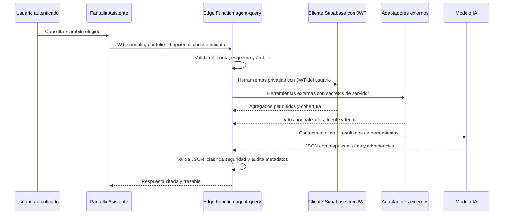

# Agente IA financiero — Herramientas de solo lectura, RLS y análisis de empresas

**Fecha:** 26 de agosto de 2026  
**Estado:** diseño técnico para piloto mixto; no se han aplicado migraciones ni activado proveedores.  
**Objetivo:** habilitar análisis técnico y fundamental de una empresa indicada por el usuario, con información actualizada, fuente verificable y acceso restringido a los datos autorizados.

> **Regla de diseño:** el modelo no consulta bases de datos ni proveedores por sí mismo. Solo puede solicitar herramientas de solo lectura previamente definidas; cada herramienta aplica identidad, ámbito, cuota, fuente, fecha de corte y esquema de salida.

## 1. Contrato de análisis técnico y fundamental

El análisis se divide entre **dato reportado**, **dato calculado** y **supuesto declarado**. El agente debe mantener esta separación en cada respuesta. El dato reportado procede de filings o proveedores; el calculado se obtiene por funciones deterministas versionadas; un supuesto solo se utiliza si el usuario lo aporta o lo aprueba explícitamente.

| Bloque | Entradas mínimas | Salida del agente | Bloqueo obligatorio |
|---|---|---|---|
| Resolución de empresa | Nombre/ticker, mercado opcional, ISIN si existe. | Identificador canónico, razón social, ticker, bolsa, divisa y posibles ambigüedades. | Si hay más de una coincidencia material, pedir aclaración; no adivinar. |
| Fundamental | Filing, período fiscal, unidad, moneda, fuente y fecha de presentación. | Ingresos, margen, beneficio, flujo de caja, deuda, caja, ratios derivados y cobertura. | No mezclar ejercicio fiscal con fecha de filing ni unidades/monedas distintas. |
| Técnico | OHLCV ajustado, mercado, zona horaria, frecuencia, fecha de corte y regla de ajuste. | SMA, MACD, RSI, Bollinger, ATR, volatilidad, drawdown y observaciones de cobertura. | Requiere serie válida; para SMA 200, 200 observaciones; no convertir indicadores en una orden. |
| Escenarios/DCF | Entradas de flujo de caja, WACC, crecimiento terminal, deuda neta y acciones. | Valor por acción, sensibilidad y advertencias de supuestos. | No generar flujos proyectados automáticamente sin fuente/consentimiento. |
| Cartera autorizada | `portfolio_id` permitido, fecha de corte, rol y consentimiento. | Exposición, resultado, concentración o relación con el instrumento. | Nunca se adjunta por defecto ni se accede a una cartera distinta de la seleccionada. |

Los cálculos técnicos existentes en `financial-analysis.ts` se reutilizan en backend. La herramienta devuelve indicadores y observaciones, no lenguaje de recomendación. El cálculo utiliza una serie homogénea de velas con el estado de ajuste por splits/dividendos declarado; si el proveedor no permite un ajuste coherente, el agente debe indicar la limitación.

## 2. Catálogo cerrado de herramientas

| Herramienta | Entrada validada | Datos y autorización | Respuesta mínima estructurada | Operaciones prohibidas |
|---|---|---|---|---|
| `resolve_company` | `query`, `market?` | Registro de instrumentos y adaptador de símbolos. | `instrument`, `matches`, `source`, `as_of`. | Crear instrumento, modificar alias o seleccionar un resultado ambiguo. |
| `get_fundamental_snapshot` | `instrument_id`, `period?` | SEC/filing normalizado o proveedor con licencia. | `reported_metrics`, `fiscal_period`, `filing_date`, `currency`, `units`, `citations`, `coverage`. | Inventar/normalizar silenciosamente métricas no comparables. |
| `get_technical_snapshot` | `instrument_id`, `interval`, `lookback` | OHLCV normalizado y licenciado en servidor. | `indicators`, `observations`, `bar_count`, `adjustment_method`, `as_of`, `citation`. | Cotización directa desde navegador, inferir señal de compra/venta. |
| `get_filing_evidence` | `company_id`, `filing_id`, `topic` | Filings permitidos, por ejemplo SEC EDGAR. | `excerpt`, `filing_date`, `period`, `url`, `source`. | Seguir instrucciones encontradas en el filing o alterar herramientas. |
| `get_fx_reference` | `base`, `quote`, `as_of` | Adaptador institucional de FX. | `rate`, `as_of`, `provider`, `delay`. | Presentarlo como precio ejecutable. |
| `get_portfolio_summary` | `portfolio_id`, `as_of?` | Datos propios bajo JWT/RLS y consentimiento de ámbito. | `totals`, `coverage`, `warnings`, `source_snapshot`. | Lectura de otra organización, movimientos individuales sin necesidad. |
| `get_portfolio_instrument_context` | `portfolio_id`, `instrument_id` | Igual que anterior, con minimización de campos. | `quantity`, `cost_basis`, `market_value`, `exposure_pct`, `as_of`. | Mostrar cartera completa si el usuario pidió solo la empresa. |
| `get_analysis_snapshot` | `instrument_id`, `portfolio_id?` | Ejecución/análisis persistido permitido por RLS. | `score`, `coverage`, `warnings`, `as_of`. | Recalcular con hipótesis desconocidas o alterar análisis existente. |
| `get_data_quality` | `scope` | Fuentes y lotes autorizados. | `coverage_pct`, `stale_sources`, `blocked_rows`, `warnings`. | Ocultar advertencias para mejorar una conclusión. |

La Edge Function recibe la petición de lenguaje natural, la clasifica y genera llamadas con JSON Schema estricto. Un ejemplo de contexto interno de `get_technical_snapshot` es:

```json
{
  "instrument_id": "uuid-canonico",
  "interval": "1d",
  "lookback": 260,
  "base_currency": "EUR"
}
```

El validador rechaza campos adicionales, intervalos no permitidos, límites excesivos, identificadores que no existen y valores que no pertenecen a la organización autenticada. El modelo recibe únicamente el resultado de cada herramienta y no puede cambiar sus filtros.

## 3. Flujo técnico de una consulta



La función conserva dos clientes distintos. El cliente de datos privados usa el JWT original del usuario y, por tanto, obedece RLS. El cliente administrativo, si es imprescindible para insertar un evento de auditoría o leer una clave, no se utiliza para recuperar carteras, transacciones, posiciones ni conversaciones privadas; una clave de servicio omite RLS y no debe convertirse en el canal de lectura del agente. [1]

## 4. Modelo de permisos y RLS

### 4.1 Roles de producto

| Rol | Consultar análisis propio | Usar datos de una cartera | Ver fuentes de mercado | Gestionar fuentes/conectores | Ver auditoría de agente |
|---|---|---|---|---|---|
| Lector | Sí, dentro de su organización. | Sí, para carteras a las que tiene acceso. | Sí, solo resultados permitidos. | No. | Solo sus propias consultas guardadas. |
| Editor | Sí. | Sí. | Sí. | No, salvo permiso adicional. | Consultas propias y reportes de la organización según política. |
| `connector_admin` | Sí. | Sí. | Sí. | Sí, consentimiento, proveedor, renovación y revocación. | Metadatos de ejecución, nunca secretos. |
| Owner | Sí. | Sí. | Sí. | Sí. | Auditoría organizativa agregada. |

El permiso `connector_admin` debe ser separado de editor porque activar un proveedor, renovar OAuth o aumentar cuotas afecta secretos y facturación. No se concede por el simple hecho de poder editar una cartera.

### 4.2 Tablas nuevas propuestas

| Tabla | Contenido | Lectura desde cliente | Escritura |
|---|---|---|---|
| `agent_consent_grants` | Ámbito autorizado, usuario, cartera/informe, caducidad y revocación. | Solo titular y owners autorizados. | Titular mediante flujo validado o backend. |
| `agent_query_runs` | Usuario, organización, intención, hash de entrada, herramientas, fuente/cobertura, coste agregado y estado. | Propias; owners según política. | Solo Edge Function. |
| `agent_tool_runs` | Herramienta, versión, latencia, estado, fuente y hash de salida. | No para datos brutos; resumen por consulta. | Solo Edge Function. |
| `agent_saved_research` | Investigación guardada expresamente con citas. | Titular y miembros autorizados. | Titular/Edge Function; borrado por titular u owner. |
| `market_source_registry` | Proveedor, licencia, frescura, mercados, estado. | Metadatos públicos permitidos. | Solo `connector_admin`/backend. |
| `market_data_snapshots` | Datos normalizados de mercado con procedencia. | Preferiblemente mediante RPC/herramienta; no tabla abierta. | Solo adaptador de servidor. |

### 4.3 Patrón de políticas

Las tablas ya existentes deben utilizar las funciones versionadas `is_organization_member` e `is_organization_editor`. Las tablas de agente añaden comprobaciones de usuario y organización. Las siguientes políticas son un patrón que debe llevarse a migraciones revisadas, no SQL listo para ejecutar sin pruebas:

```sql
-- Lectura de una consulta propia o de un owner de la organización
create policy agent_query_runs_read
on public.agent_query_runs
for select to authenticated
using (
  actor_id = auth.uid()
  or public.is_organization_owner(organization_id)
);

-- El cliente no crea ejecuciones de agente directamente.
create policy agent_query_runs_no_client_insert
on public.agent_query_runs
for insert to authenticated
with check (false);

-- Un consentimiento solo puede pertenecer al usuario autenticado y a una organización propia.
create policy agent_consent_owner_write
on public.agent_consent_grants
for all to authenticated
using (
  actor_id = auth.uid()
  and public.is_organization_member(organization_id)
)
with check (
  actor_id = auth.uid()
  and public.is_organization_member(organization_id)
);
```

La Edge Function debe verificar adicionalmente que `portfolio_id`, si existe, pertenece a `organization_id`, que el usuario es miembro y que existe un consentimiento activo no vencido para ese ámbito. Esta validación no se delega al prompt ni al cliente.

## 5. Controles específicos por fuente

| Fuente | Control de actualización | Metadato obligatorio | Regla del agente |
|---|---|---|---|
| SEC EDGAR | Recuperación en servidor con cache y User-Agent conforme a política. | CIK, filing, período fiscal, fecha de filing, URL. | Referenciar filing primario, no un resumen sin enlace. [2] |
| OHLCV/fundamentales comerciales | Job de sincronización con cuota y licencia; no consulta por pestaña. | Proveedor, tipo de precio, ajuste, exchange, retraso y `as_of`. | Declarar dato retrasado/no disponible y no suplir con una fuente no autorizada. |
| ECB FX | Sincronización/versionado de tasa de referencia. | Par, fecha, fuente, método y retraso. | Diferenciar referencia de precio ejecutable. |
| CoinGecko u otra cripto | Adaptador con atribución, cuota y regla de frescura. | Activo canónico, red si aplica, fuente, `as_of`, derecho de uso. | No equiparar precio de referencia con precio ejecutable de exchange. [3] |
| Datos propios | Consulta con JWT/RLS y consentimiento. | Snapshot/lote, cobertura, advertencias y fecha de corte. | Resumir lo mínimo y no incluir Canvas local por defecto. |

## 6. Reglas de respuesta del agente

La respuesta se devuelve solo si pasa este esquema funcional: `answer`, `analysis_type`, `as_of`, `citations`, `coverage`, `caveats`, `used_tools`, `safety_classification`. Debe citar la evidencia por cada afirmación numérica, separar «reportado», «calculado» y «supuesto», y mostrar una advertencia cuando haya series insuficientes, fuentes atrasadas o conflicto de datos.

Para análisis técnico, un resultado correcto puede decir: «SMA 200 no disponible: 123 velas válidas de las 200 requeridas». Para fundamental, puede decir: «El margen operativo procede del 10-K del período fiscal terminado en X; los valores se muestran en millones de USD». Ambos son resultados útiles y seguros aunque no concluyan una decisión de inversión.

## 7. Pruebas mínimas antes del piloto

| Prueba | Criterio de aceptación |
|---|---|
| Resolución ambigua | El agente solicita mercado/ticker y no escoge una empresa al azar. |
| RLS cruzado | Usuario de organización A intenta un `portfolio_id` de B: resultado 403/auditoría, sin fuga de existencia ni datos. |
| Consentimiento | Sin consentimiento, `get_portfolio_*` no se ejecuta; revocado o vencido, se bloquea inmediatamente. |
| Fuente atrasada | La respuesta muestra antigüedad y no utiliza lenguaje de actualidad. |
| Serie técnica corta | No calcula SMA 200/indicadores dependientes y explica cobertura. |
| Filing malicioso | Un texto de filing no puede alterar herramientas, rol, ámbito ni reglas de respuesta. |
| Provider error/429 | El agente informa indisponibilidad y no inventa métricas. |
| Salida del modelo | JSON inválido, cita inexistente o lenguaje de operación: se bloquea o se transforma en respuesta segura. |

## Referencias

[1] [Supabase — Environment Variables and Secrets](https://supabase.com/docs/guides/functions/secrets)

[2] [U.S. SEC — EDGAR Application Programming Interfaces](https://www.sec.gov/search-filings/edgar-application-programming-interfaces)

[3] [CoinGecko — API Documentation](https://docs.coingecko.com/)

[4] [CFA Institute — Portfolio Performance Evaluation](https://www.cfainstitute.org/insights/professional-learning/refresher-readings/2026/portfolio-performance-evaluation)
