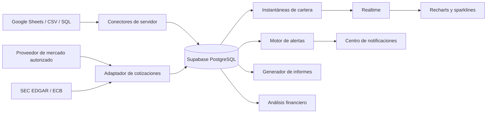

# Arquitectura de datos reactivos y proveedores de mercado

**Autor:** Manus AI  
**Fecha:** 22 de agosto de 2026  
**Estado:** diseño de implementación condicionado a la autorización y configuración de Supabase y Google Workspace.

## Decisión arquitectónica

Portafolio Intel debe usar **Supabase PostgreSQL como fuente de verdad de los datos de usuario** y como canal de actualización de los paneles. La cotización nunca se consultará desde el navegador: un adaptador backend recuperará, validará y almacenará datos con su fuente, marca temporal, retraso y derecho de uso. El frontend recibirá solamente instantáneas normalizadas mediante suscripciones de Realtime y renderizará las series con Recharts.

Esta separación evita exponer claves de proveedores, reduce peticiones duplicadas desde cada pestaña y permite que las alertas, informes y cálculos fiscales sean repetibles contra un lote de datos versionado. El plan gratuito de Supabase incluye Postgres, cambios de Postgres en tiempo real y un límite de 2 millones de mensajes Realtime al mes, por lo que es suficiente para un MVP de uso contenido, aunque no garantiza actividad continua tras una semana sin uso.[1]

## Contrato de datos

| Tabla | Propósito | Campos de control obligatorios |
|---|---|---|
| `data_sources` | Registra Sheets, archivos y conectores SQL. | `owner_id`, `provider`, `status`, `last_success_at`, `schema_version`. |
| `sync_runs` | Traza cada lectura y normalización. | `source_id`, `trigger`, `started_at`, `status`, `accepted_rows`, `rejected_rows`, `checksum`. |
| `transactions` | Libro de operaciones inmutable. | `external_id`, `occurred_at`, `kind`, `quantity`, `gross_amount`, `fees`, `currency`, `source_run_id`. |
| `positions` | Posición actual derivada de transacciones. | `instrument_id`, `quantity`, `cost_basis`, `as_of`. |
| `market_quotes` | Observaciones de precio con procedencia. | `instrument_id`, `price`, `currency`, `provider`, `provider_at`, `observed_at`, `delay_seconds`, `license_scope`. |
| `portfolio_snapshots` | Agregados preparados para gráficas. | `portfolio_id`, `as_of`, `market_value`, `gain`, `return_pct`, `source_version`. |
| `alerts` | Alertas evaluadas, deduplicadas y auditables. | `rule_id`, `fingerprint`, `severity`, `status`, `triggered_at`, `payload_version`. |
| `report_runs` | Informes reproducibles. | `report_type`, `period_start`, `period_end`, `input_snapshot`, `status`, `storage_path`. |
| `audit_events` | Evidencia de acceso, reglas, exportaciones y cambios. | `actor_id`, `action`, `entity_type`, `entity_id`, `created_at`, `metadata`. |

Cada tabla de negocio se protegerá con **RLS por propietario/organización** y las credenciales se separarán de las tablas de lectura de aplicación. Un borrado o una corrección no altera el lote original: genera un evento de reversión o versión posterior.

## Tiempo real y sparklines

El navegador se suscribe únicamente a las filas de `portfolio_snapshots`, `market_quotes` y `alerts` que le permite RLS. Al llegar una fila validada, se actualiza el caché de consulta y Recharts recalcula el gráfico sin recargar la página. No se abrirá una conexión WebSocket directa desde cada navegador hacia Finnhub, Twelve Data o CoinGecko; esas conexiones requieren claves y sus condiciones de uso no habilitan el uso de cliente del MVP.[2] [3]

| Capa | Responsabilidad | Medida de seguridad |
|---|---|---|
| Adaptador backend | Recupera datos, aplica limitador, normaliza y escribe. | Clave en secreto de servidor; reintentos exponenciales y caché. |
| Base de datos | Conserva dato crudo, normalizado y agregados. | RLS, restricciones, checksums y marcas de tiempo. |
| Realtime | Publica cambio de las tablas permitidas. | Canal con sesión autenticada; no publica secretos ni proveedor sin permiso. |
| Frontend | Muestra valor, frescura, fuente y retraso. | Nunca llama al proveedor ni interpreta un dato retrasado como en vivo. |

El modelo de caché empleará `instrument_id + provider_at` como clave idempotente. Para reducir mensajes, la interfaz recibirá una nueva instantánea solo cuando cambie el valor redondeado de presentación, expire el máximo de silencio o se modifique el estado de mercado. El histórico completo queda en `market_quotes`; las sparklines consultan ventanas agregadas de uno, cinco o quince minutos según el derecho de uso del proveedor.

## Política de proveedores

| Caso de uso | Decisión para MVP | Restricción que lo justifica |
|---|---|---|
| Cartera, fiscalidad y P2P | Datos importados o sincronizados por el usuario. | Son las fuentes que acreditan las operaciones y sus importes. |
| Fundamentales US | SEC EDGAR, procesado en servidor. | EDGAR no requiere API key y ofrece presentaciones/XBRL, pero no cotizaciones.[4] |
| Tipos de cambio de referencia | ECB Data Portal. | Fuente institucional para series/metadata, no precio ejecutable intradía.[5] |
| Cripto experimental | CoinGecko Demo con atribución y control de cuota. | El plan Demo es gratuito, pero limitado a 10.000 créditos/mes y datos desde 60 segundos; no entrega WebSocket.[3] |
| Cotizaciones para clientes | Deshabilitadas hasta registrar proveedor y licencia comercial. | Los planes gratuitos de Finnhub y Twelve Data son personales o de uso interno/no-display.[2] [6] |

## Alertas, informes y cumplimiento

Las alertas se evaluarán de manera determinista al persistir un cambio de posición, una cotización validada o una nueva fecha de calendario. Las reglas se versionan y se guardan con sus umbrales; su `fingerprint` evita repetir la misma alerta hasta que se resuelva. Las notificaciones empiezan en el centro de la aplicación y se amplían a web push o correo solamente tras configurar el canal y consentimiento del usuario.

Los PDF se generarán desde una instantánea cerrada (`input_snapshot`) y se almacenarán de forma privada con enlace firmado de corta duración. Los informes fiscales y los modelos tributarios se marcarán como **borradores para revisión**; un control de cobertura bloquea la generación definitiva si hay fuentes sin conciliar, operaciones sin identificador, conversión de divisas pendiente o reglas fiscales sin revisar. La aplicación no presentará documentos ante la AEAT.

## Módulo de análisis financiero

El módulo extra se implementará como una vista informativa con tres niveles de dato: **reportado**, **calculado** y **estimación del usuario**. El score, DCF, indicadores técnicos y Kelly solo se ejecutan cuando sus entradas contienen fuente, fecha y cobertura suficientes. El sistema expondrá los pesos y las fórmulas, el periodo de observación, el porcentaje de datos faltantes y las advertencias de validez. No emitirá una orden de compra, venta ni una promesa de resultado.

## Secuencia de despliegue

1. Conectar Supabase y crear el proyecto/credenciales del servidor.
2. Conectar Google Workspace y completar OAuth para una hoja de prueba sin datos sensibles.
3. Aplicar migraciones, RLS, Storage privado y tablas de auditoría.
4. Sustituir los arrays de demostración por consultas reales y suscripciones Realtime.
5. Activar fuentes institucionales SEC/ECB para fundamentales/FX y registrar metadatos de origen.
6. Añadir un proveedor de cotizaciones comercial únicamente cuando se vayan a mostrar datos a clientes y se conozcan mercados, activos y audiencia.
7. Activar alertas e informes solo sobre lotes conciliados y versionados.

## Referencias

[1] [Supabase — Pricing and Realtime limits](https://supabase.com/pricing)  
[2] [Finnhub — Free plan, license and WebSocket coverage](https://finnhub.io/pricing)  
[3] [CoinGecko — Demo plan, freshness and commercial plans](https://www.coingecko.com/en/api/pricing)  
[4] [U.S. SEC — EDGAR APIs](https://www.sec.gov/search-filings/edgar-application-programming-interfaces)  
[5] [European Central Bank — Data Portal API](https://data.ecb.europa.eu/help/api/overview)  
[6] [Twelve Data — Basic plan and display restrictions](https://twelvedata.com/pricing)
