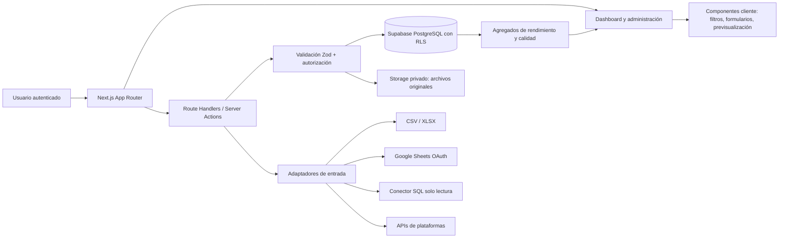

# Portafolio Intel — investigación, alcance y arquitectura técnica

**Fecha:** 22 de agosto de 2026  
**Autor:** Manus AI  
**Estado:** Base de producto y arquitectura para la primera entrega

## 1. Resumen ejecutivo

**Portafolio Intel** debe ser una aplicación web de gestión patrimonial que reúna en una vista única las posiciones de inversión procedentes de varias plataformas. Su objetivo no es recomendar compras o ventas, sino reducir la fricción de consolidar datos y convertirlos en señales de decisión verificables: valor, rentabilidad, evolución, asignación, exposición por plataforma, liquidez y calidad de los datos.

La revisión ha detectado una diferencia relevante entre el material adjunto y el repositorio seleccionado. Los documentos adjuntos describen una solución madura con módulos, datos de ejemplo y una arquitectura futura; sin embargo, el repositorio contiene actualmente el *starter* de Next.js 16. Por tanto, la decisión correcta es **construir un MVP vertical y validable desde una base limpia**, evitando dar por implementadas capacidades que aún solo están documentadas.

> **Decisión de producto:** el primer corte funcional se centra en el inventario de plataformas, la incorporación trazable de datos y la comparación de rendimiento por plataforma. Las conexiones bancarias, fiscalidad automática y recomendaciones de inversión quedan fuera del MVP operativo y se mantienen en el *roadmap*.

| Resultado esperado | Cómo se materializa en el MVP | Criterio de éxito |
|---|---|---|
| Consolidación | Registro de plataformas, posiciones y métricas de rendimiento por fuente | Una persona puede filtrar el tablero por una o varias plataformas en pocos pasos |
| Entrada de datos sin fricción | Alta manual, carga CSV/XLSX y preparación de Google Sheets y conectores | Cada carga muestra una previsualización y las incidencias antes de confirmar |
| Decisión informada | KPIs, ranking de plataformas, evolución, distribución y alertas de calidad | Se identifica la plataforma con mejor rendimiento y el grado de confianza del dato |
| Seguridad desde el diseño | Sin credenciales de terceros en el navegador; modelo multiusuario y trazabilidad planificados | Las integraciones reales usan OAuth o secretos cifrados del lado servidor |

## 2. Contexto, usuario objetivo y problema

La aplicación está dirigida inicialmente al **inversor particular avanzado**, el asesor independiente y el pequeño *family office* que reparte posiciones entre brokers, bancos, fondos, P2P/crowdlending, efectivo y otros activos. El problema no es solo visualizar el patrimonio, sino comparar fuentes heterogéneas sin confundir saldo actual, coste, cobros, divisa y rendimiento.

Los adjuntos ya delimitan un universo amplio —panel consolidado, P2P, renta variable, simulación fiscal, rebalanceo, calendario y multimoneda—. Debe conservarse como visión de producto, pero el primer despliegue debe resolver antes un flujo completo de confianza: **crear plataforma → incorporar datos → validar y normalizar → consultar y filtrar → entender el rendimiento**.

## 3. Investigación de mercado y tendencias

La investigación contrastó la propuesta con productos de consolidación, seguimiento y carga de datos. Las funciones indicadas para los competidores provienen de su documentación y páginas de producto; se presentan como capacidades declaradas por cada proveedor, no como una auditoría independiente.

| Competidor | Capacidades documentadas | Señal de mercado | Implicación para Portafolio Intel |
|---|---|---|---|
| **getquin** | Agregación de cuentas, rendimiento, costes, impuestos, dividendos, análisis por clase de activo y carga por API, manual o CSV. [1] | El usuario espera varios canales de incorporación, no una única integración bancaria. | Priorizar un modelo de ingestión común y una experiencia homogénea para alta manual, ficheros y conectores. |
| **Sharesight** | Importación guiada de operaciones históricas, mapeo de columnas, revisión de errores y cálculo de rendimiento ponderado por dinero. [2] | El asistente de mapeo y la revisión previa son parte esencial de una importación fiable. | Incorporar previsualización, mapeo explícito, validación de campos obligatorios y un lote de importación auditable. |
| **Portfolio Performance** | Asistente CSV con delimitador, codificación, mapeo configurable y categorías distintas para operaciones, efectivo, valores y cotizaciones. [3] | El CSV real es heterogéneo; un único formato rígido genera abandono. | Diseñar un esquema canónico de transacciones y adaptadores por origen, en vez de codificar un parser por plataforma en la interfaz. |
| **Kubera** | Agregación de cuentas, activos alternativos, multimoneda, acceso granular y consolidación de entidades. [4] | La consolidación evoluciona desde acciones/ETFs hacia patrimonio multi-activo y multi-entidad. | Mantener un modelo extensible de tipo de activo, propietario y entidad, aunque el MVP muestre los activos financieros prioritarios. |
| **Delta by eToro** | Sincronización de brokers, selección entre saldos u operaciones y comunicación explícita de límites de historial y discrepancias. [5] | La calidad y cobertura de cada fuente condiciona la validez de las métricas. | Mostrar cobertura, fecha de actualización, método de entrada y advertencias de conciliación junto al rendimiento. |

Tres tendencias son especialmente relevantes. En primer lugar, los líderes combinan automatización y alternativas manuales porque la conectividad no es universal ni siempre devuelve un historial completo. Delta advierte de límites de historial, diferencias de saldo y frecuencias de sincronización; por ello, la procedencia del dato no puede ocultarse detrás de un único número de rentabilidad. [5]

En segundo lugar, el mercado favorece importadores asistidos que aceptan exportaciones imperfectas. Sharesight admite una ruta de importación con revisión y mapeo, mientras Portfolio Performance expone explícitamente codificación, delimitadores, vista previa y configuraciones reutilizables. [2] [3] Portafolio Intel debe competir en **confianza y control de la ingesta**, no únicamente en número de gráficos.

En tercer lugar, la evolución europea hacia *open finance* recomienda separar claramente consentimiento, propósito, acceso y revocación. La Comisión Europea plantea un marco en el que el cliente conserva el control sobre quién accede a sus datos y con qué finalidad, junto con interfaces estandarizadas y protección de datos. [6] Esto justifica que las credenciales, renovaciones y sincronizaciones no se gestionen desde el navegador ni se incorporen a la primera versión sin un proveedor homologado.

## 4. Posicionamiento y propuesta de valor

Portafolio Intel debe diferenciarse mediante una combinación de **comparabilidad por plataforma**, control de la calidad del dato y una experiencia de decisión sobria. La aplicación no debe ocultar que una plataforma tiene datos parciales, que la rentabilidad no incluye flujos completos o que una cifra depende de una carga manual.

> **Propuesta de valor:** “Consolida tus inversiones, conoce qué plataforma contribuye realmente a tu resultado y decide con datos trazables, no con hojas de cálculo dispersas.”

| Diferenciador | Diseño propuesto | Beneficio para el usuario |
|---|---|---|
| Rendimiento por plataforma | Ranking configurable por rentabilidad, ganancia, TIR futura y calidad de datos | Permite identificar la fuente que aporta más valor sin confundir tamaño y rendimiento |
| Evidencia y confianza | Indicador de origen, última actualización, cobertura e incidencias de cada plataforma | Evita interpretar como exacto un dato incompleto |
| Ingesta abierta pero segura | Alta manual, CSV/XLSX, Google Sheets y conectores mediante adaptadores | Permite empezar hoy sin bloquear la evolución hacia automatización |
| Modelo multi-activo | Posiciones, efectivo, P2P y flujos bajo un esquema común | Reduce rediseños cuando se añadan nuevas plataformas o activos |
| Interfaz de decisión | KPIs, filtro persistente, comparador y explicaciones de métricas | Prioriza la comprensión antes que la densidad visual |

## 5. Alcance funcional priorizado

El alcance se ha priorizado mediante valor para la decisión, dependencia técnica, seguridad y velocidad de respuesta. Las etiquetas **MVP**, **Siguiente** y **Posterior** representan la secuencia recomendada, no una promesa de fecha.

| Prioridad | Funcionalidad | Alcance concreto | Justificación |
|---|---|---|---|
| **MVP** | Administración de plataformas | Crear, editar, archivar y clasificar plataformas; tipo, país, divisa base, método de datos y estado | Es la entidad necesaria para cualquier comparación posterior |
| **MVP** | Tablero filtrable | Filtro por plataforma y segmento; KPIs de valor, coste, ganancia y rentabilidad; ranking comparativo | Responde directamente a “ver cuál rinde más” |
| **MVP** | Carga de CSV y Excel | Selector de archivo, detección de columnas, vista previa, validación, resumen de filas y errores | Es el canal de incorporación más rápido sin exponer secretos |
| **MVP** | Alta manual de registros | Formulario para añadir una posición o un resumen de rendimiento de una plataforma | Evita bloquear la adopción cuando no hay exportación disponible |
| **MVP** | Trazabilidad mínima | Fuente, fecha de actualización, lote de importación e incidencias visibles | Sin trazabilidad, la comparación carece de fiabilidad |
| **MVP** | Acceso a Google Sheets preparado | Validación de URL, estado de conexión y contrato de adaptador; conexión real queda condicionada a OAuth y credenciales de proyecto | Mantiene la puerta abierta sin tratar enlaces o tokens de forma insegura |
| **Siguiente** | Importador canónico de transacciones | Mapeo guardable por plataforma, deduplicación y conciliación de saldos | Mejora escalabilidad y evita recargas manuales repetitivas |
| **Siguiente** | Conector de base de datos seguro | Adaptador del lado servidor, acceso de solo lectura, secretos cifrados y consulta limitada | Permite conectividad sin abrir una base de datos al cliente |
| **Siguiente** | Métricas avanzadas | TWRR, MWRR/XIRR, rendimiento neto de comisiones, efecto divisa y comparador temporal | La comparación de plataformas será más precisa cuando existan flujos completos |
| **Siguiente** | Usuarios, roles y auditoría | Autenticación, organizaciones, RLS, permisos de administrador/lector y registro de acciones | Requisito para datos reales y colaboración segura |
| **Posterior** | Sincronizaciones automáticas | Open Banking/Open Finance, APIs de brokers y ejecución en segundo plano | Requiere contratos, consentimiento y observabilidad operativa |
| **Posterior** | Fiscalidad y rebalanceo | FIFO, escenarios fiscales, reglas de asignación y órdenes sugeridas | Aporta valor, pero depende de transacciones confiables y de reglas locales |
| **Posterior** | Análisis de inversión | DCF, técnico, *scoring*, alertas y explicaciones | Debe ser apoyo informativo, nunca recomendación individual no supervisada |

## 6. Experiencia de usuario propuesta

La interfaz debe tener una estructura de herramienta profesional: barra lateral persistente, encabezado compacto, filtros visibles y zona de contenido de lectura rápida. El diseño inicial empleará fondo claro cálido, tarjetas blancas con elevación suave, acento azul petróleo, verde para resultados positivos, ámbar para advertencias de calidad y rojo solo para errores o pérdida. La información financiera se debe presentar con color y texto para no depender únicamente de señales cromáticas.

| Vista | Contenido y comportamiento | Decisión que habilita |
|---|---|---|
| **Resumen** | Valor consolidado, ganancia, rentabilidad, gráfico temporal y tabla de plataformas ordenable | Dónde está el capital y qué plataforma aporta más resultado |
| **Plataformas** | Tarjetas/listado, estado, método de entrada, última actualización, calidad e indicadores de rendimiento | Qué fuentes están activas, desactualizadas o incompletas |
| **Administración** | Formulario de plataforma y selector de método: manual, CSV, Excel, Google Sheets o base de datos | Añadir una fuente sin perder contexto ni introducir credenciales en el navegador |
| **Importar datos** | Arrastrar archivo, previsualización, asignación de columnas y panel de incidencias | Confirmar que lo cargado representa correctamente las posiciones/operaciones |
| **Detalle de plataforma** | Posiciones, evolución, composición, flujos e historial de importaciones | Comprender por qué una plataforma aparece como mejor o peor |

Las métricas de comparación deben estar explicadas en línea. En la primera versión se mostrarán **rentabilidad simple calculada sobre valor inicial**, **ganancia absoluta** y **valor actual**. Si una plataforma contiene flujos o historial parcial, el interfaz debe etiquetarla como *estimación basada en datos disponibles*. La TIR/XIRR y la rentabilidad ponderada por tiempo se incorporarán cuando el esquema canónico tenga todas las transacciones, fechas y flujos necesarios.

## 7. Arquitectura técnica recomendada

La solución debe conservar **Next.js 16, React 19, TypeScript y Tailwind CSS 4** ya presentes en el repositorio. Se recomienda un diseño *server-first*: las páginas y lecturas privadas se renderizan como Server Components; únicamente tablas, filtros, carga de fichero y formularios quedan como Client Components aislados. Este patrón reduce JavaScript inicial y evita trasladar secretos al navegador.

En producción, la persistencia debe ser **Supabase PostgreSQL** con RLS por organización y usuario. Supabase reúne autenticación, PostgreSQL, almacenamiento y reglas por fila en una solución adecuada para una primera versión segura. Todas las tablas que contengan datos de cartera llevarán `organization_id`, `owner_id`, marcas temporales y, cuando aplique, `source_id`. Los datos confidenciales de conexión no se incluirán en las tablas de negocio sin cifrado de aplicación y rotación de claves.

| Capa | Decisión | Motivo de seguridad y rendimiento |
|---|---|---|
| Presentación | Next.js App Router, Server Components por defecto, Tailwind y componentes accesibles | Menor carga de JavaScript y navegación rápida; controles interactivos aislados |
| Validación | Zod compartido entre interfaz y servidor | Contratos consistentes, errores explícitos y rechazo temprano de entradas inválidas |
| Datos | PostgreSQL/Supabase con RLS, índices por organización, plataforma y fecha | Aislamiento multiusuario y consultas filtradas eficientes |
| Archivos | Storage privado con URL firmada, límite de tamaño, allowlist MIME y análisis de cabecera | Evita exposición pública, tipos ejecutables y cargas excesivas |
| Conectores | Adaptadores solo del lado servidor, OAuth cuando exista; nunca contraseñas en el cliente | Reduce exposición de secretos y permite revocación centralizada |
| Rendimiento | Agregados diarios/por plataforma, paginación y filtros de servidor | Evita recalcular toda la cartera ante cada interacción |
| Observabilidad | Registros estructurados, auditoría de importación y métricas de error | Acelera diagnóstico sin registrar información financiera sensible |

### 7.1 Modelo de datos mínimo

| Entidad | Campos clave | Finalidad |
|---|---|---|
| `organizations` | `id`, `name`, `created_at` | Contenedor de aislamiento multiusuario |
| `memberships` | `organization_id`, `user_id`, `role` | Roles de administrador, editor y lector |
| `platforms` | `id`, `organization_id`, `name`, `category`, `base_currency`, `data_method`, `status` | Catálogo de brokers, P2P, bancos, hojas o fuentes manuales |
| `data_sources` | `platform_id`, `kind`, `sync_state`, `last_synced_at`, `quality_score` | Configuración y salud del origen, sin secreto en claro |
| `import_batches` | `id`, `data_source_id`, `file_path`, `status`, `row_count`, `accepted_count`, `rejected_count` | Trazabilidad completa de cada carga |
| `positions` | `platform_id`, `instrument_id`, `quantity`, `cost_basis`, `market_value`, `as_of_date` | Posición consolidable al cierre de una fecha |
| `transactions` | `platform_id`, `instrument_id`, `kind`, `occurred_at`, `quantity`, `gross_amount`, `fees`, `currency`, `external_id` | Base futura de fiscalidad y métricas exactas |
| `platform_metrics` | `platform_id`, `as_of_date`, `market_value`, `gain_loss`, `simple_return`, `coverage_state` | Agregado rápido para tabla, ranking y filtros |
| `audit_events` | `actor_id`, `entity_type`, `entity_id`, `action`, `created_at`, `metadata_safe` | Auditoría sin registrar secretos ni contenido financiero completo |

### 7.2 Flujo de ingestión de datos

El flujo debe tratar todo fichero como no confiable. Se aceptan `CSV` y `XLSX` con tamaño limitado; el servidor comprueba tipo, cabecera, estructura y número de filas. La interfaz solo confirma la importación después de exponer una previsualización, columnas no mapeadas, duplicados y errores por fila. La normalización transforma cada entrada a `positions` o `transactions` mediante un adaptador específico de plataforma.

| Método | MVP actual | Producción recomendada |
|---|---|---|
| Manual | Formulario guiado para plataforma y registro de rendimiento | Server Action validada y persistida con auditoría |
| CSV | Lectura local, previsualización y normalización de columnas comunes | Carga a storage privado, análisis antivirus, mapeo versionado y deduplicación |
| Excel | Lectura local de libros XLSX y previsualización de la primera hoja | Igual que CSV, con selección de hoja y límites de celdas/formulas |
| Google Sheets | Captura y validación de URL; estado “requiere autorización” | OAuth 2.0 de Google con permisos mínimos, refresco de token cifrado y acceso por hoja específica |
| Base de datos | Formulario de intención, sin aceptar ni guardar credenciales en el navegador | Agente/adaptador de solo lectura, allowlist de IP, TLS, secreto cifrado y consulta parametrizada limitada |

## 8. Requisitos de seguridad y cumplimiento

Los datos de inversión son altamente sensibles. La aplicación debe aplicar minimización, separación de privilegios y transparencia sobre cada fuente. El marco europeo de acceso a datos financieros pone el control del cliente, la finalidad y la estandarización en el centro del intercambio de datos. [6]

| Riesgo | Control obligatorio |
|---|---|
| Acceso cruzado entre usuarios | RLS por `organization_id`, comprobación de sesión en cada mutación y pruebas de aislamiento |
| Exposición de credenciales | OAuth o secretos cifrados del lado servidor; ninguna contraseña ni cadena de conexión en cliente, logs o `localStorage` |
| Archivo malicioso o excesivo | Allowlist CSV/XLSX, validación de firma/tamaño, límites de filas, almacenamiento privado y análisis asíncrono |
| Manipulación de importes o fórmulas | Parser de valores no ejecutable, sanitización, validación por esquema y reglas de precisión decimal |
| Comparación engañosa | Etiqueta de cobertura, fecha de actualización, método de rendimiento y estado de conciliación |
| Abuso de API | Rate limiting, protección CSRF en mutaciones, CSP, HSTS, cookies `HttpOnly`, `Secure` y `SameSite` |
| Pérdida de trazabilidad | Lotes inmutables, identificador externo de transacción, deduplicación y registro de auditoría |

## 9. Plan de entrega recomendado

| Hito | Contenido | Resultado verificable |
|---|---|---|
| **Entrega actual** | Dashboard, administración de plataformas, filtro, ranking y entrada de datos de demostración CSV/XLSX | El flujo principal se puede recorrer de extremo a extremo desde el navegador |
| **Iteración 1** | Autenticación, Supabase, RLS, persistencia y auditoría | Cada organización ve exclusivamente su propia cartera |
| **Iteración 2** | Importador servidor, adaptadores, Google Sheets OAuth y conector SQL de solo lectura | Los datos dejan de ser de demostración y las importaciones son trazables |
| **Iteración 3** | Transacciones normalizadas, XIRR/TWRR, conciliación y multimoneda | Comparación exacta y explicable entre plataformas |
| **Iteración 4** | Fiscalidad, rebalanceo, alertas e informes | Extensión controlada sobre datos confiables |

## 10. Criterios de aceptación del MVP

El MVP se considerará completo cuando un usuario pueda añadir una plataforma, escoger un método de entrada, cargar o simular datos de ejemplo, ver una previsualización con errores identificados y consultar el resultado filtrado por plataforma. La tabla comparativa debe poder ordenarse y explicar la métrica empleada. La interfaz debe ser responsive, navegable con teclado, presentar foco visible y mantener contraste WCAG AA.

Además, el proyecto debe compilar sin errores de TypeScript y el flujo principal debe validarse manualmente en navegador. La entrega no debe afirmar conectividad real a bases de datos, Google Sheets o brokers mientras no existan autenticación, persistencia segura y los permisos correspondientes.

## Referencias

[1]: https://www.getquin.com/portfolio-tracker/ "getquin — Real-time portfolio tracker"
[2]: https://help.sharesight.com/import_bulk_trades/ "Sharesight Help — Bulk import historical buy and sell trades"
[3]: https://help.portfolio-performance.info/en/reference/file/import/csv-import/ "Portfolio Performance Manual — Importing a CSV file"
[4]: https://www.kubera.com/portfolio-tracker "Kubera — Portfolio Tracker"
[5]: https://support.delta.app/en/articles/5765798-broker-account-connections "Delta by eToro Help — Broker Account Connections"
[6]: https://finance.ec.europa.eu/digital-finance/framework-financial-data-access_en "European Commission — Framework for financial data access"
