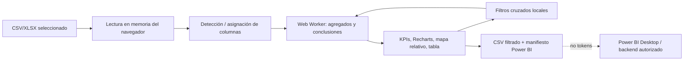

# Análisis de vídeos y diseño del Canvas local

**Autor:** Manus AI  
**Fecha:** 25 de agosto de 2026  
**Estado:** funcionalidades de dashboard local implementadas en el cliente; la incrustación segura de Power BI queda preparada mediante exportación y manifiesto, sin credenciales en navegador.

## Síntesis de los vídeos

Los dos vídeos describen una misma aspiración con dos aproximaciones complementarias. El primero plantea un BI generado a partir de la estructura de una hoja, que después procesa el archivo real en el navegador con interacciones de filtros, gráficos conectados, tablas, mapas y un resumen ejecutivo. El segundo muestra el patrón Canvas en Google Sheets: una capa de dashboard que permite partir de lenguaje natural y sincronizar las vistas con los datos de la hoja.

| Capacidad observada | Traducción en Gestor financiero | Estado |
|---|---|---|
| Carga dinámica de Excel/CSV | Zona de arrastrar y soltar con lectura local de CSV y XLSX. | Implementado. |
| Privacidad sin compartir filas | No se usa `localStorage`, Supabase ni IA dentro del Canvas; el archivo se mantiene en memoria de la pestaña. | Implementado. |
| Procesamiento en segundo plano | `Web Worker` para el agregado de registros y KPIs cuando el navegador lo admite. | Implementado, con cálculo local de respaldo. |
| Selección y segmentación | Filtros por fecha, categoría, plataforma y geografía; los KPI, gráficos, mapa, tabla y conclusiones se recalculan juntos. | Implementado. |
| KPI de negocio | Valor filtrado, filas analizadas, media por fila y variación del último período. | Implementado. |
| Líneas, donut y barras | Gráficos Recharts de tendencia, categoría y plataforma. | Implementado. |
| Mapa por región | Mapa de exposición relativa en función de la columna geográfica. | Implementado sin geocodificación ni envío externo. |
| Tabla granular | Tabla verificable de filas filtradas. | Implementado. |
| Lectura ejecutiva | Conclusiones deterministas basadas en concentración, plataforma, variación y cobertura geográfica. | Implementado. |
| Modificación bidireccional de origen | Requiere un conector autorizado con confirmación, auditoría y reglas de validación. | No implementado; se mantiene deliberadamente fuera del Canvas local. |
| Prompt/IA para construir vistas | Necesita un servicio de IA y consentimiento explícito para enviar estructura/datos. | No implementado en el modo privado. |

> El Canvas local no intenta emular una recomendación de inversión. Las conclusiones son reglas visibles y reproducibles que se limitan al archivo que el usuario abrió localmente.

## Modelo de privacidad aplicado

El workspace se puede abrir sin cuenta desde la pantalla inicial, por lo que no necesita autenticación, organización ni peticiones a la base de datos. El usuario elige un archivo local; su contenido se analiza en memoria y se elimina al recargar, cerrar la pestaña o pulsar **«Eliminar de memoria»**. El sistema no persiste las filas mediante `localStorage`, `sessionStorage`, IndexedDB ni Supabase.

| Riesgo | Control implementado |
|---|---|
| Envío accidental de filas a la aplicación principal | El Canvas no importa el cliente Supabase ni ejecuta ninguna consulta de red. |
| Bloqueo de interfaz con archivos medianos | Los agregados se envían a un `Web Worker` cuando está disponible. |
| Confusión entre muestra y datos reales | El ejemplo se etiqueta como ficticio y se descarta al cerrar la pestaña. |
| Inferencias opacas | Las conclusiones son reglas deterministas y se declara el criterio de lectura. |
| Exposición en Power BI | No se incrusta un reporte ni se aceptan tokens en cliente; se exportan únicamente CSV filtrado y manifiesto. |

## Arquitectura del Canvas

El modelo reconoce de forma editable las columnas de fecha, valor, categoría, plataforma, geografía y estado. La detección inicial acelera la configuración, pero el usuario puede corregir cualquier asignación antes de utilizar la lectura. El mapa no consume una API externa: sitúa burbujas relativas y advierte que no es cartografía legal.

## Opciones Power BI propuestas

El modo local incluye **«Exportar CSV filtrado»** y **«Descargar manifiesto BI»**. El manifiesto entrega el mapeo de columnas, filtros y número de filas, sin datos de autenticación ni secretos. Es el patrón apropiado para preparar un modelo en Power BI Desktop o para que un backend controlado genere un token de inserción.

Power BI Embedded permite restringir las filas visibles mediante RLS, ocultar tablas/columnas mediante OLS y aislar espacios de trabajo por cliente; estas alternativas deben configurarse en el modelo semántico y en el servicio, no en código cliente [1]. Los marcadores permiten capturar y restaurar el estado de filtros y visuales de un informe incrustado [2]. Si en una fase posterior se exportan reportes de Power BI, la exportación puede respetar RLS y filtros, aunque exige capacidades y permisos específicos [3].

| Opción | Cuándo usarla | Salvaguarda obligatoria |
|---|---|---|
| CSV + manifiesto local | Auditoría, Power BI Desktop o análisis puntual sin nube de la aplicación. | No añadir credenciales, tokens ni PII innecesaria al archivo. |
| Embed para organización | Usuarios internos autenticados por Microsoft Entra. | RLS dinámico y filtros aplicados por el backend. |
| Embed para clientes | Producto multiempresa con reportes externos. | Token de inserción efímero emitido por servidor, RLS/OLS y aislamiento de organización. |
| Exportación PDF/PPTX de Power BI | Entregables formalizados desde un reporte corporativo. | Revisar licencia/capacidad, aplicar RLS y sensibilidad antes de descargar. |

## Diferenciación entre datos persistentes y Canvas local

La aplicación mantiene dos trayectorias. **Portafolio Intel persistente** usa Supabase para datos conciliados, Realtime, alertas e informes de cartera; requiere autenticación y aplica RLS. **Canvas local** acepta datos abiertos por el usuario para exploración temporal, sin guardarlos ni sincronizarlos. Esto permite elegir entre colaboración y analítica local sin mezclar garantías de privacidad.

## Referencias

[1] [Microsoft Learn — Security features in Power BI Embedded](https://learn.microsoft.com/en-us/power-bi/developer/embedded/embedded-row-level-security)  
[2] [Microsoft Learn — Enhance user experience with bookmarks](https://learn.microsoft.com/en-us/javascript/api/overview/powerbi/report-bookmarks)  
[3] [Microsoft Learn — Export Power BI report to file](https://learn.microsoft.com/en-us/power-bi/developer/embedded/export-to)
