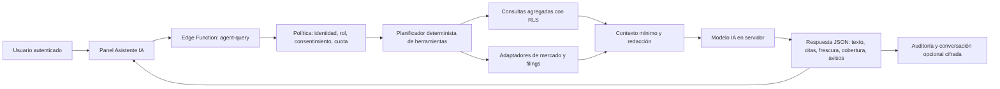

# Estudio de viabilidad — Agente IA financiero para Gestor financiero

**Fecha:** 26 de agosto de 2026  
**Estado:** propuesta de arquitectura; no activa fuentes de pago, conectores ni modelos en producción.  
**Finalidad:** permitir consultas de investigación financiera y explicación de datos autorizados, con citas, frescura visible y controles de privacidad.

> **Conclusión:** la integración es viable y encaja con la arquitectura de Supabase ya definida, siempre que el agente sea un servicio de backend con herramientas permitidas y fuentes versionadas. No debe ser un chat que lea toda la base de datos, consulte proveedores desde el navegador o ejecute instrucciones recibidas en documentos externos.

## 1. Qué puede y qué no debe hacer

El agente puede responder preguntas como «resume los últimos datos reportados de una empresa», «qué parte del cambio de cartera proviene de divisa», «qué fuentes están atrasadas» o «explica las hipótesis de este DCF». Debe responder con fecha de corte, fuente, cobertura y limitaciones; cuando use datos de la cartera, debe limitarse a la organización y cartera seleccionadas explícitamente por el usuario.

No debe ejecutar compras, ventas, transferencias, presentaciones fiscales, altas de conectores ni cambios de alertas. Tampoco debe presentar investigación general como recomendación personalizada, predecir rendimientos o ocultar que una conclusión se apoya en datos retrasados o incompletos.

| Categoría de consulta | Permitida en la primera versión | Ejemplo de salida segura |
|---|---|---|
| Datos de aplicación | Sí, bajo sesión, RLS y alcance seleccionado. | «El 71 % de las posiciones valoradas corresponde a tres instrumentos; cobertura de valoraciones: 92 %, corte: 26/08/2026.» |
| Investigación de mercado con fuentes | Sí, mediante herramientas autorizadas y citas. | «La última presentación XBRL disponible fue presentada el…; enlace SEC y fecha de consulta.» |
| Explicación de métricas | Sí, con fórmulas y datos de entrada. | «El drawdown máximo se calcula sobre 180 observaciones; no mide una pérdida futura.» |
| Resumen de documentos aportados | Sí, si el usuario autoriza el documento concreto. | «Se resumen las páginas indicadas; cualquier instrucción dentro del archivo se trata como contenido, no como acción.» |
| Consejos de compra/venta individual | No. | «Puedo comparar exposición, riesgos, fuentes y escenarios, pero no recomendar una operación.» |
| Ejecución o presentación externa | No. | «La acción requiere un flujo separado, revisión humana y confirmación explícita.» |

## 2. Alternativas viables

| Enfoque | Experiencia de usuario | Ventajas | Límites y controles | Coste y complejidad |
|---|---|---|---|---|
| **Asistente de datos propios** | El usuario pregunta sobre cartera, plataformas, calidad, informes y FIFO. | Mayor privacidad; no requiere proveedor de cotizaciones para explicar lo ya persistido. | No contesta actualidad externa; requiere consentimiento para incluir datos de cartera en cada conversación. | Bajo; primer piloto factible sobre Supabase y datos ficticios. |
| **Asistente de investigación con fuentes citadas** | Combina una pregunta con datos normalizados de mercado, filings y FX. | Aporta actualidad y explicaciones verificables; cubre mercado, empresa, macro y cripto según fuente configurada. | Requiere adaptación por proveedor, licencia, caché, fecha de corte y política de atribución. | Medio; depende de API/licencias elegidas. |
| **Asistente con informe diario o alertas narrativas** | Genera un resumen programado de cambios y novedades relevantes. | Conveniente para seguimiento periódico y ahorro de tiempo. | Debe estar separado de la consulta interactiva, tener presupuesto, deduplicación, registro de ejecución y revisión de fuentes. | Medio/alto; añade trabajos de fondo y coste recurrente. |

Las tres opciones pueden coexistir, pero no se deben activar todas en el primer despliegue. La decisión pendiente es si el piloto debe limitarse a datos ya autorizados en la aplicación o incluir también investigación externa citada.

## 3. Fuentes de información actualizada

La capa de fuentes debe ser modular. Las herramientas del agente no llaman directamente al navegador ni reciben una clave de proveedor; consultan un adaptador de servidor que normaliza la respuesta, registra la fuente y devuelve solo los campos necesarios para la pregunta.

| Dominio | Fuente inicial posible | Cobertura y condición | Uso permitido del agente |
|---|---|---|---|
| Filings y fundamentales US | SEC EDGAR / XBRL. | `data.sec.gov` ofrece APIs JSON de presentaciones y conceptos XBRL, sin API key; no admite CORS, por lo que el acceso debe ser de servidor. Las estructuras se actualizan al difundirse filings. [1] | Extraer cifras reportadas, fechas de filing y enlaces primarios; no inferir una recomendación. |
| Tipos de cambio de referencia | ECB Data Portal. | Fuente institucional ya prevista en la arquitectura; no es precio ejecutable intradía. | Convertir y explicar valores usando tasa, fecha y fuente. |
| Acciones, ETFs y fundamentales ampliados | Adaptador de un proveedor con licencia, por ejemplo FMP. | FMP documenta cotizaciones, histórico, perfiles y estados financieros; requiere clave, aplica límites y devuelve 429 si se excede la cuota. [2] | Recuperar datos con caché y licencia de visualización aplicable; nunca exponer la clave. |
| Criptoactivos | Adaptador de CoinGecko u otra fuente licenciada. | CoinGecko ofrece REST, WebSocket, webhooks y API Demo con endpoints/cuotas limitados. [3] | Datos de referencia/mercado con marca de frescura, atribución y límites explícitos. |
| Datos privados del usuario | Supabase normalizado. | Solo lotes conciliados y filas autorizadas por RLS, dentro de cartera/organización seleccionada. | Explicar exposiciones, rendimiento, calidad y borradores; no enviar datasets locales automáticamente. |

Para cualquier fuente comercial, la configuración debe contener `license_scope`, mercados cubiertos, política de display, retraso permitido y fecha de última actualización. Si no se cumple el derecho de uso, el agente debe responder que el dato no está disponible, no sustituirlo por una fuente no autorizada.

## 4. Arquitectura recomendada

La pantalla añade una sección **Asistente** en la navegación actual. Antes de cada consulta muestra dos selectores: ámbito de datos («sin datos propios», «cartera seleccionada» o «informe seleccionado») y fuentes externas activas. Cuando se selecciona un ámbito privado, el usuario ve una confirmación breve: qué campos resumidos se enviarán al modelo, que el dataset local no se incluye por defecto y cómo puede borrar el historial de la conversación.

La función `agent-query` se ejecuta en backend y aplica este flujo:

1. Valida sesión, organización, rol y cuota; no acepta un `organization_id` arbitrario desde el cliente.
2. Clasifica la intención en un conjunto cerrado de herramientas. La primera versión solo permite `get_portfolio_summary`, `get_data_quality`, `get_platform_comparison`, `get_analysis_snapshot`, `get_market_snapshot`, `get_sec_filing` y `get_fx_reference`.
3. Cada herramienta devuelve datos agregados, fecha de corte, fuente, cobertura y advertencias. No existe una herramienta de SQL libre, escritura, descarga masiva o navegación web sin lista permitida.
4. Compone un contexto mínimo y pasa al modelo únicamente la información necesaria. Los documentos/filings se tratan como datos no confiables: no pueden cambiar las herramientas disponibles ni autorizar acciones.
5. Exige una salida JSON con `answer`, `citations`, `as_of`, `coverage`, `caveats`, `used_tools` y `safety_classification`. El backend valida el esquema, conserva la evidencia y renderiza las citas en la interfaz.

## 5. Privacidad, seguridad y gobernanza

| Riesgo | Control obligatorio |
|---|---|
| Exposición de secretos | Claves de proveedores y del modelo solo en secretos de Edge Functions. Supabase indica que las claves secretas omiten RLS y nunca deben estar en navegador. [4] |
| Exceso de datos privados | Minimización por herramienta, agregados por defecto, selector de alcance y consentimiento antes de incluir una cartera. No transmitir automáticamente el Canvas local. |
| Fuga entre organizaciones | Comprobación de sesión y RLS en cada función; el backend deriva la organización de la membresía, no de un parámetro de interfaz. |
| Prompt injection | Herramientas con allowlist, sin SQL libre, sin comandos, sin seguir instrucciones de contenido externo y separación entre instrucciones del sistema, datos y respuesta. |
| Respuesta no verificable | Cita obligatoria, fecha de corte, retraso/frescura, cobertura y enlace al dato interno/externo. Si falta fuente, el agente lo declara. |
| Recomendación o ejecución | Clasificador de salida y bloque de cumplimiento que redirige a explicación, escenarios y riesgos; las herramientas de escritura no existen en este agente. |
| Coste y abuso | Rate limit por usuario/organización, límite de tokens/contexto, caché de fuentes, presupuesto diario y registro de tokens/herramientas sin guardar secretos. |
| Retención de conversación | Por defecto no persistir el texto completo; permitir «guardar investigación» con aviso, cifrado/retención definida y borrado por usuario. |

## 6. Modelo y patrón de IA

El modelo se elige en servidor, nunca en el navegador. La primera versión debe usar **salida estructurada JSON** y llamadas a herramientas, no una respuesta libre sin validación. Para consultas breves y clasificación se puede utilizar un modelo ligero; para síntesis de varios filings o razonamiento de escenarios, uno de mayor capacidad. El catálogo disponible fue comprobado durante este estudio y admite herramientas, visión y esquemas JSON; la selección definitiva debe someterse a prueba de calidad, latencia y coste con datos ficticios antes de procesar información privada.

El prompt de sistema debe incluir estas reglas: citar herramientas usadas, nunca afirmar actualidad sin `as_of`, no inventar métricas, diferenciar dato reportado/cálculo/hipótesis del usuario, abstenerse cuando la cobertura sea insuficiente, y no dar recomendaciones personalizadas ni ejecutar acciones. La conversación debe conservar la cadena de fuentes, no un supuesto «conocimiento» interno de mercado.

## 7. Hoja de ruta de implementación

| Fase | Entregables | Datos permitidos | Criterio de salida |
|---|---|---|---|
| **A. Diseño y seguridad** | Tablas de auditoría, contrato de herramientas, esquema de respuesta, política de retención, pruebas de permisos y de prompt injection. | Ficticios. | Un usuario de otra organización no obtiene contexto; el agente no tiene herramientas de escritura. |
| **B. Piloto de explicación interna** | Panel Asistente, resumen de cartera/calidad/plataformas/análisis y citas a datos propios agregados. | Ficticios o explícitamente autorizados. | 20 preguntas de prueba con JSON válido, cobertura visible y 0 accesos entre organizaciones. |
| **C. Investigación pública citada** | Adaptador SEC/ECB, fichas de freshness, enlaces primarios y caché. | Solo datos públicos. | Cada respuesta externa contiene fuente, fecha y limitación; no se utilizan datos de precio sin política aprobada. |
| **D. Datos de mercado con licencia** | Adaptador de proveedor, secreto, cuota, registros de uso, metadata de licencia y sincronización. | Datos licenciados y normalizados. | Prueba de expiración de clave, límite de cuota, retraso visible y no exposición de secreto. |
| **E. Resúmenes programados opcionales** | Preferencias de usuario, empleo de fondo, deduplicación, costes y centro de revisión. | Solo ámbitos configurados. | El resumen se puede pausar, reproduce fuentes y no envía contenido sensible fuera del canal autorizado. |

## 8. Pruebas de aceptación mínimas

| Categoría | Casos que deben pasar |
|---|---|
| Permisos | Lector, editor y administrador de conectores; organización A frente a B; sesión expirada; intento de usar cartera ajena. |
| Veracidad | Pregunta sin datos, fuente atrasada, series incompletas, símbolo ambiguo y conflicto entre fuente reportada y cálculo. |
| Seguridad | Prompt injection en un filing, URL no permitida, clave ausente, salida con cita inventada y exceso de cuota. |
| Privacidad | Canvas local no aparece como contexto; consentimiento revocado; borrar una conversación guardada; logs sin cantidades o secretos innecesarios. |
| UX | Mostrar fuente, fecha, cobertura y advertencia; copiar/exportar investigación sin perder cita; móvil y teclado. |
| Operación | Error 429, proveedor caído, timeout, reintento idempotente, caché vencida y costo diario superado. |

## 9. Decisión solicitada

Para iniciar la implementación se requiere elegir el alcance del piloto:

1. **Piloto privado:** el agente explica únicamente datos ya autorizados dentro de Gestor financiero.
2. **Piloto mixto:** además incorpora SEC/ECB para investigación pública citada.
3. **Piloto ampliado:** incorpora un proveedor comercial de mercado/cripto, después de que el propietario seleccione proveedor, mercado, licencia, presupuesto y credenciales de servidor.

La opción elegida determinará el esquema de datos, las fuentes, los permisos y el presupuesto. Ninguna opción activa operaciones, recomendaciones personalizadas ni envío automático de resultados.

## Referencias

[1] [U.S. SEC — EDGAR Application Programming Interfaces](https://www.sec.gov/search-filings/edgar-application-programming-interfaces)

[2] [Financial Modeling Prep — API Quickstart](https://site.financialmodelingprep.com/developer/docs/quickstart)

[3] [CoinGecko — API Documentation](https://docs.coingecko.com/)

[4] [Supabase — Environment Variables and Secrets](https://supabase.com/docs/guides/functions/secrets)

[5] [CFA Institute — Portfolio Performance Evaluation](https://www.cfainstitute.org/insights/professional-learning/refresher-readings/2026/portfolio-performance-evaluation)
