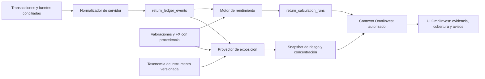

# OmniInvest y libro mayor normalizado: riesgo y concentración explicables

**Fecha:** 28 de agosto de 2026  
**Estado:** diseño técnico; no se han creado tablas, activado Realtime ni conectado datos reales.  
**Ámbito:** enriquecer OmniInvest con un contexto de cartera autorizado y derivado del libro mayor normalizado, sin cambiar su modo local manual/ficticio.

## 1. Principio de integración

OmniInvest local continúa calculando solo lo que una persona introduce en memoria. El contexto de cartera es una capacidad diferente y futura: se construye en servidor a partir de eventos normalizados, valoraciones y FX con procedencia. La pantalla no leerá `return_ledger_events` directamente desde el navegador, no usará el Canvas local como entrada implícita y no sustituirá métricas ausentes por una puntuación aparentemente precisa.

> **Regla de aislamiento:** el libro mayor es evidencia de cálculo; OmniInvest recibe una proyección autorizada, mínima y versionada. No recibe archivos de importación, secretos de conectores ni movimientos crudos que no sean necesarios para el indicador solicitado.



## 2. Datos mínimos y procedencia

La capa derivada necesita una taxonomía controlada de instrumentos, no texto libre. Cada posición valorada debe poder asignarse, cuando exista evidencia, a emisor, activo, sector, geografía, moneda de riesgo, plataforma/cuenta y grupo económico. La clasificación no se infiere silenciosamente desde el ticker: su fuente, versión, fecha y cobertura forman parte de la salida.

| Entrada del libro mayor | Uso en riesgo/concentración | Condición para usarla |
| --- | --- | --- |
| `return_ledger_events` | Reconstrucción de unidades, flujos, costes e incidencias de conciliación. | `quality` no bloqueado y vínculo a cartera/organización válido. |
| `portfolio_valuations` | Denominador de exposición, ventana temporal y cobertura de precios. | Valoración conciliada, moneda base y fecha de corte coherentes. |
| `fx_rate_observations` | Conversión de posiciones y exposición por divisa. | Tasa positiva, fuente, fecha y calidad suficientes. |
| `return_calculation_runs` | Huella de entradas, política, algoritmo y período. | Ejecución `ready` o `review_required` explícitamente etiquetada. |
| Taxonomía de instrumento | Agrupación por emisor, clase, sector, región y moneda. | Versión/cita conocida; las clasificaciones ausentes permanecen como «sin clasificar». |

El valor sin precio, sin FX o sin taxonomía no desaparece del denominador. Se expone como **valor no cubierto** y reduce la confianza de la métrica relacionada. Por ejemplo, una concentración por sector no se etiqueta completa si parte del valor permanece sin sector conocido.

## 3. Proyección derivada y contratos TypeScript

El backend crea una proyección por `organization_id`, `portfolio_id`, `as_of`, `policy_version`, `input_fingerprint` y versión del clasificador. No se sobrescribe una ejecución anterior: se crea un snapshot nuevo o se marca el previo como `superseded`.

```ts
export type RiskDimension =
  | "instrument"
  | "issuer"
  | "asset_class"
  | "sector"
  | "geography"
  | "risk_currency"
  | "platform";

export type MetricQuality = "complete" | "partial" | "review_required" | "blocked" | "not_calculable";

export type EvidenceRef = {
  kind: "ledger_event" | "valuation" | "fx_rate" | "taxonomy" | "calculation_run";
  id: string;
  version: string;
};

export type Coverage = {
  denominatorValueBase: number | null;
  pricedValuePct: number;
  fxValuePct: number;
  taxonomyValuePct: Partial<Record<RiskDimension, number>>;
  quality: MetricQuality;
  warnings: string[];
};

export type ExposureBucket = {
  dimension: RiskDimension;
  key: string;
  label: string;
  marketValueBase: number | null;
  weightPct: number | null;
  coveragePct: number;
  evidence: EvidenceRef[];
  quality: MetricQuality;
};

export type ConcentrationMetric = {
  dimension: RiskDimension;
  top1WeightPct: number | null;
  top3WeightPct: number | null;
  hhi: number | null;
  knownBucketWeightPct: number;
  unknownBucketWeightPct: number;
  quality: MetricQuality;
  warnings: string[];
};

export type PortfolioRiskContext = {
  organizationId: string;
  portfolioId: string;
  calculationRunId: string;
  asOf: string;
  baseCurrency: string;
  policyVersion: string;
  inputFingerprint: string;
  classifierVersion: string;
  coverage: Coverage;
  exposures: ExposureBucket[];
  concentrations: ConcentrationMetric[];
  trailingRisk: {
    observationCount: number;
    annualizedVolatilityPct: number | null;
    maxDrawdownPct: number | null;
    returnSeriesQuality: MetricQuality;
    warnings: string[];
  };
  warnings: string[];
};
```

La fórmula del índice de concentración se ejecuta solo sobre ponderaciones conocidas de una dimensión y se acompaña siempre de cobertura: `HHI = Σ(wᵢ²)`, donde `wᵢ` es el peso decimal de cada bucket conocido. Un HHI no se compara automáticamente con una regla personal ni se traduce en una orden; su propósito es describir cómo se reparte el valor que sí tiene clasificación verificable.

## 4. Algoritmo de proyección

1. El endpoint de cálculo verifica JWT, pertenencia a la organización, cartera permitida y el consentimiento explícito del usuario para usarla en OmniInvest. No acepta `organization_id` impuesto por el cliente.
2. Selecciona una política de retorno inmutable y una fecha de corte. A partir de `return_calculation_runs` identifica el `input_fingerprint`, el algoritmo y la cobertura vigentes.
3. Reconstruye unidades y costes desde `return_ledger_events` del ámbito autorizado. Los reversos se aplican como eventos nuevos enlazados, no modificando la historia.
4. Une cada posición a una `portfolio_valuation` conciliada y a un `fx_rate_observation` válido. Si falta un precio/FX, conserva el valor como no cubierto.
5. Une la posición a la taxonomía de instrumento vigente para cada dimensión. Un emisor desconocido genera el bucket explícito `SIN_CLASIFICAR`, no una asignación heurística.
6. Agrupa valor base por dimensión y calcula pesos únicamente contra el valor total de la misma valoración de cartera. Calcula `top1`, `top3` y HHI sobre buckets conocidos, junto al porcentaje no clasificado.
7. Deriva volatilidad y drawdown solo con una serie de valoraciones homogénea. La salida informa número de observaciones, regla de frecuencia y huecos; no anualiza una serie insuficiente.
8. Persiste solo el snapshot derivado, sus IDs de evidencia, huellas y avisos. La UI recibe esta proyección de lectura autorizada y no los secretos ni el CSV/XLSX original.

## 5. Reglas de cobertura y estados

| Métrica | Requisito para `complete` | Resultado si falla |
| --- | --- | --- |
| Exposición por instrumento | Valoración y FX completos en el denominador. | `partial` y bucket de valor sin precio/FX. |
| Concentración por emisor/sector/región | Exposición valorada y clasificación de toda la cartera. | `partial`; muestra «sin clasificar» y no oculta el porcentaje desconocido. |
| Exposición por moneda | Valoración, moneda de riesgo y FX verificables. | `review_required` si moneda de riesgo/FX es ambigua. |
| Volatilidad/drawdown | Serie homogénea, frecuencia declarada, suficientes observaciones y sin huecos críticos. | `not_calculable` o `partial`; sin cifra anualizada engañosa. |
| Factor Riesgo de OmniInvest | Cobertura de concentración y serie de riesgo según política aprobada. | Permanece manual, se marca parcial o se bloquea; no se sobreescribe. |

La política debe definir valores de corte de cobertura, tamaño mínimo de serie, calendario y tratamiento de efectivo. Estos valores son parámetros de gobernanza versionados, no constantes de interfaz. Hasta que se aprueben, OmniInvest mostrará las métricas como información de revisión y no derivará un score automático de riesgo.

## 6. Integración de UI sin mezclar modos

La pantalla presenta dos selectores mutuamente excluyentes: **«Entrada local»** y **«Cartera autorizada»**. El primero conserva el comportamiento vigente de OmniInvest. El segundo exige seleccionar una cartera que el usuario ya puede leer, confirmar el alcance y mostrar en cabecera el corte, moneda, cobertura, política y versión. No existe un valor por defecto de cartera.

| Elemento de UI | Fuente | Salvaguarda |
| --- | --- | --- |
| Cobertura general | `coverage` derivada. | Siempre visible junto a cada métrica. |
| Top 1 / Top 3 / HHI | `concentrations` de la dimensión seleccionada. | Oculta la cifra si está bloqueada; muestra peso no clasificado. |
| Tabla de buckets | `exposures` agregados y evidencias mínimas. | No expone transacciones crudas por defecto. |
| Volatilidad y drawdown | Serie derivada de valoraciones. | Declara ventana, observaciones, frecuencia y calidad. |
| Factor «Riesgo» | Propuesta explicable de la política; no resultado opaco. | No se actualiza automáticamente ni emite acción de inversión. |

## 7. RLS, Realtime y seguridad

La integración no se desbloquea antes de cerrar los hallazgos de RLS remota y Realtime. Las tablas de ledger se escriben solo desde el normalizador de servidor y las de resultado solo desde el servicio de cálculo. `viewer` puede leer una proyección de cartera autorizada, no insertar/actualizar eventos, valoraciones, ejecuciones o líneas de puente. `editor` puede solicitar un recálculo mediante endpoint validado, nunca escribir una métrica derivada desde el cliente.

Realtime publica, tras la validación RLS, únicamente un cambio de `return_calculation_runs` o de una cabecera de contexto. El cliente filtra por cartera autorizada, agrupa ráfagas y hace refetch del dominio de retorno con versión/huella. No se publica `return_ledger_events`, movimientos crudos, fuentes, secretos ni errores de proveedor en el canal.

| Prueba de seguridad | Resultado requerido |
| --- | --- |
| Usuario A solicita `portfolio_id` de B. | `403` sin confirmar que la cartera existe y sin contexto OmniInvest. |
| Cuenta con permiso de lectura intenta insertar una línea de exposición. | Denegación por grants y RLS. |
| Realtime recibe cambio de B. | No llega al canal de A ni invalida su pantalla. |
| Taxonomía/FX ausente. | Cobertura disminuye; nunca se rellena por heurística. |
| Recalcular mismo `input_fingerprint`. | Resultado idempotente o ejecución existente; sin duplicar eventos. |
| Exportar contexto. | Solo proyecciones permitidas, sin `connection_config`, tokens ni fórmulas ejecutables. |

## 8. Plan de implementación seguro

| Fase | Entrega | Dependencia y criterio de salida |
| --- | --- | --- |
| P0 | Cerrar RLS/Realtimes actuales en staging. | Pruebas A/B, grants/policies/vistas/funciones revisadas y coalescencia por dominio. |
| P1 | Aprobar política y taxonomía. | Moneda base, efectivo, fronteras de flujo, cobertura y vocabulario de clasificación versionados. |
| P1 | Crear migración y proyector en staging. | FKs compuestas, DML de servidor, snapshots idempotentes y datos sintéticos. |
| P1 | Implementar cálculos de exposición. | Cuadres de valor y cobertura; sin score automático de riesgo. |
| P2 | Añadir UI de cartera autorizada. | Consentimiento explícito, desglose, evidencia y estados de calidad visibles. |
| P2 | Realtime de resultados. | Solo cabeceras autorizadas, versión de respuesta y test de ráfagas/reconexión. |

## 9. Pruebas deterministas propuestas

1. **CONC-001, cartera completa:** tres instrumentos ficticios con valoraciones/FX/taxonomía completos. Pesos, top 1, top 3 y HHI cuadran con el denominador de cartera.
2. **CONC-002, sector sin clasificar:** una posición sin sector. La suma de buckets conocidos más `SIN_CLASIFICAR` es 100 %, la cobertura sectorial baja y el estado no es `complete`.
3. **CONC-003, precio ausente:** una posición tiene unidades pero no valoración. Su valor no se fuerza a cero; la métrica queda `partial`/`review_required` según política.
4. **CONC-004, FX ausente:** una posición no está en moneda base y falta tasa. No entra como importe convertido ficticio y la cobertura FX disminuye.
5. **CONC-005, reverso:** una operación y su reverso dejan la exposición y huella esperadas sin borrar la evidencia.
6. **RISK-001, serie suficiente:** valoraciones homogéneas sintéticas producen volatilidad/drawdown junto a recuento y cobertura.
7. **RISK-002, serie corta:** no publica métrica anualizada cuando faltan observaciones mínimas.
8. **RISK-003, hueco crítico:** el diagnóstico declara el hueco y no lo interpola sin política explícita.
9. **RLS-OMNI-001:** usuario B no puede leer/solicitar/recibir el contexto de cartera de A.
10. **RT-OMNI-001:** diez eventos de una misma ejecución terminan en una actualización de dominio; una respuesta de huella antigua se descarta.

## 10. Límites

Esta propuesta no implementa una recomendación de inversión ni determina tolerancia de riesgo personal. La concentración y las métricas de serie son descripciones de datos con cobertura conocida. Un proveedor, clasificación, modelo de riesgo, actualización automatizada o análisis por IA solo se incorporará tras autorizar su fuente, licencia, retención, privacidad, RLS, secreto de servidor y pruebas de staging.

## Referencias

[1]: ./ESPECIFICACION_PRUEBAS_Y_ESQUEMA_RETORNOS_2026-08-27.md "Especificación del libro mayor, rendimiento y atribución"
[2]: ./CONTRATOS_TWR_FLUJOS_IRREGULARES_2026-08-27.md "Contratos TWR y flujos irregulares"
[3]: ./ESTRATEGIA_MITIGACION_RLS_REALTIME_2026-08-27.md "Estrategia de cierre RLS y Realtime"
[4]: ./AGENTE_IA_HERRAMIENTAS_Y_RLS.md "Herramientas de solo lectura y RLS"

---

**Divulgación.** Diseño de producto y seguridad, preparado sin carteras, instrumentos, cotizaciones ni transacciones reales. No es asesoramiento financiero personalizado ni habilita ejecución de operaciones.
