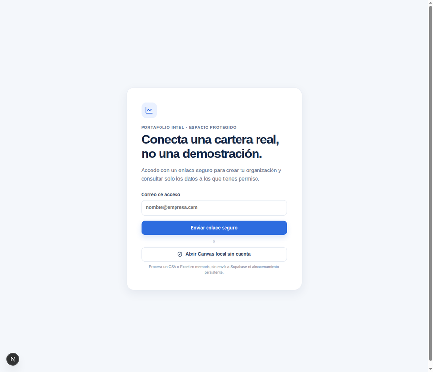
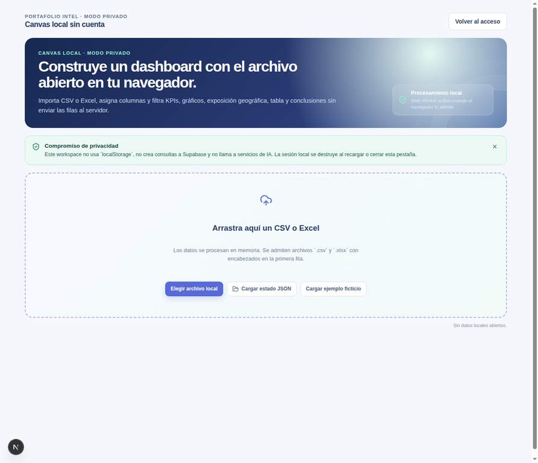
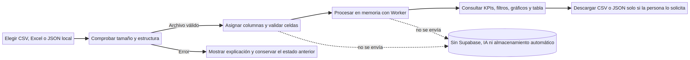
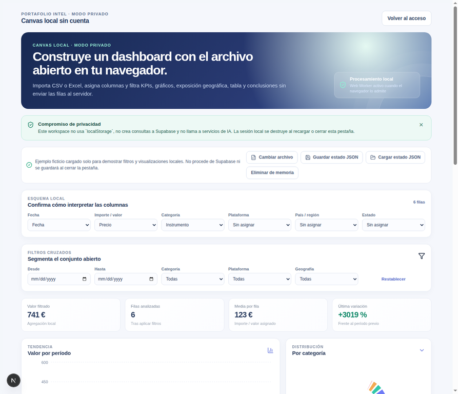
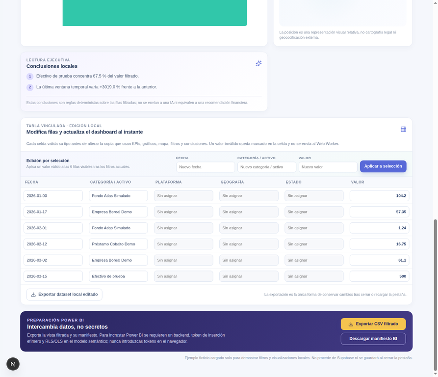
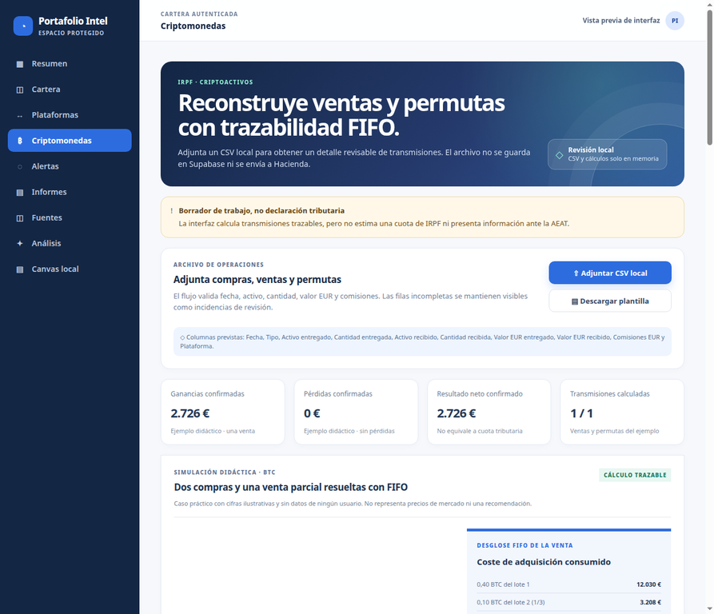
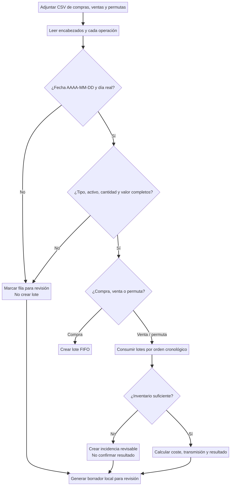
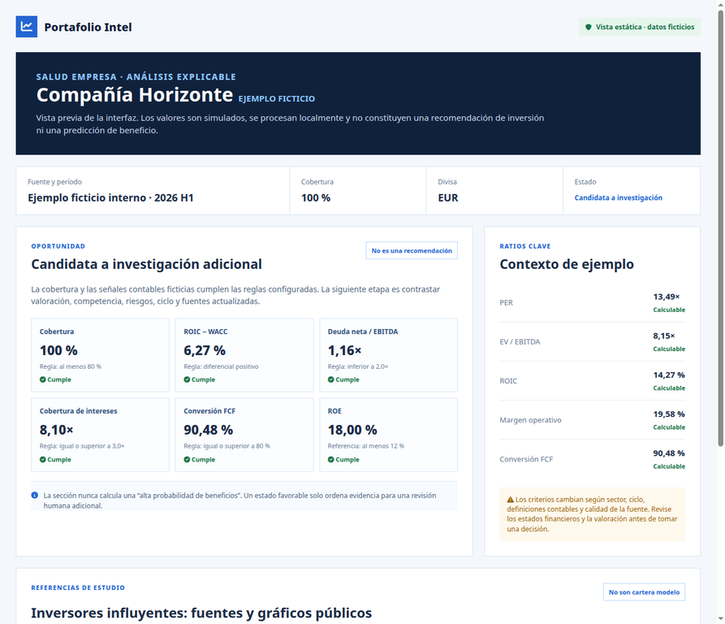
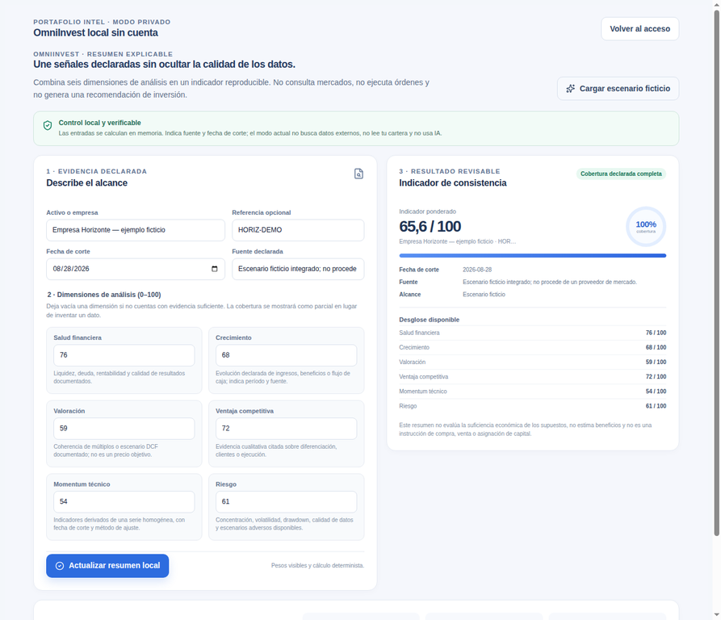

# Manual de usuario

# Gestor financiero · Portafolio Intel

**Edición:** agosto de 2026  
**Dirigido a:** personas que empiezan a organizar inversiones y usuarios con experiencia que desean revisar sus datos de forma ordenada.  
**Autor:** Manus AI para el proyecto Gestor financiero.

> **Propósito del manual.** Este documento explica cómo usar cada espacio de la aplicación con palabras sencillas, recorridos por tarea, ejemplos y apoyos visuales. Está diseñado para poder consultar solo el apartado que se necesite, en lugar de leerse necesariamente de principio a fin. Esta forma de estructurar una guía —índice navegable, instrucciones breves, ejemplos y solución de problemas— se inspira en las buenas prácticas divulgadas por UserGuiding y Document360.[1] [2]

> **Privacidad primero.** El **Canvas local** y el cálculo de **Criptomonedas** procesan los archivos seleccionados en la memoria del navegador. No envían esos archivos a Supabase, inteligencia artificial, Google Sheets ni a un almacenamiento permanente por defecto. Al recargar o cerrar la pestaña se pierde el trabajo que no se haya descargado explícitamente como archivo local.

> **Información, no asesoramiento.** Las cifras, ratios, filtros y estados sirven para organizar y revisar información. No son una recomendación personalizada de inversión, una orden de compra o venta, una predicción de beneficios, ni asesoramiento fiscal. El borrador de Criptomonedas no presenta ni firma declaraciones ante la AEAT; debe revisarse con documentación propia y, cuando corresponda, con un profesional.

*Figura 1. Punto de partida de la aplicación. Captura de instancia local; no contiene datos financieros privados.*

---

## Índice

1. [Antes de empezar](#antes-de-empezar)
2. [Conocer los dos modos de uso](#conocer-los-dos-modos-de-uso)
3. [Inicio rápido: analizar un archivo local](#inicio-rápido-analizar-un-archivo-local)
4. [Canvas local: cargar, revisar y entender los datos](#canvas-local-cargar-revisar-y-entender-los-datos)
5. [Canvas local: editar, filtrar, guardar y exportar](#canvas-local-editar-filtrar-guardar-y-exportar)
6. [Área protegida: cartera, plataformas y fuentes](#área-protegida-cartera-plataformas-y-fuentes)
7. [Criptomonedas: borrador FIFO revisable](#criptomonedas-borrador-fifo-revisable)
8. [Salud empresa y sección OPORTUNIDAD](#salud-empresa-y-sección-oportunidad)
9. [OmniInvest local](#omniinvest-local)
10. [Cálculos automáticos y fórmulas](#cálculos-automáticos-y-fórmulas)
11. [Informes, alertas y Asistente](#informes-alertas-y-asistente)
12. [Buenas prácticas de privacidad y seguridad](#buenas-prácticas-de-privacidad-y-seguridad)
13. [Solución de problemas](#solución-de-problemas)
14. [Glosario](#glosario)
15. [Límites conocidos y uso responsable](#límites-conocidos-y-uso-responsable)
16. [Referencias](#referencias)

---

## Antes de empezar

Gestor financiero tiene dos propósitos complementarios. El primero es permitir una **revisión rápida y privada** de un archivo propio desde el Canvas local, sin crear una cuenta para ese análisis puntual. El segundo es reunir información de cartera en el **área protegida**, cuando el usuario inicia sesión y dispone de los permisos correspondientes.

Prepare una copia de trabajo de sus datos antes de importarlos. Si el archivo contiene movimientos reales, elimine o reemplace primero cualquier dato que no necesite para el análisis, por ejemplo nombres, identificadores de cuenta, direcciones o notas personales. Para aprender a usar la herramienta, use siempre el ejemplo ficticio incluido o una copia inventada.

| Lo que conviene tener preparado | Para qué sirve | Recomendación práctica |
| --- | --- | --- |
| Archivo CSV, Excel (`.xlsx`) o JSON | Canvas local | Empiece con un archivo pequeño y ficticio para comprobar el mapeo. |
| Encabezados comprensibles | Detección y asignación de columnas | Use nombres como `Fecha`, `Instrumento`, `Tipo`, `Cantidad`, `Precio`, `Divisa` o `Plataforma`. |
| Justificantes y operaciones históricas | Cálculo FIFO de cripto | Conserve compras, ventas, permutas, comisiones y valores en EUR. |
| Fuente y fecha de referencia | Salud empresa | Anote de dónde procede cada cifra y el período contable. |
| Un lugar seguro para las descargas | Respaldo manual | Guarde los JSON y CSV exportados en una carpeta cifrada o con acceso restringido. |

### Señales importantes que verá en pantalla

La aplicación emplea mensajes de estado para que pueda decidir qué hacer antes de seguir. No ignore una advertencia solo porque se muestre un resultado parcial.

| Señal | Qué significa | Qué hacer |
| --- | --- | --- |
| **Listo / calculado** | Se han podido procesar los datos necesarios para esa vista. | Revise el resultado y su fuente antes de usarlo. |
| **Pendiente de revisión** | Hay información incompleta, incoherente o no calculable. | Abra la tabla, corrija la fila o complete los datos que faltan. |
| **No significativo** | La ratio no tiene una interpretación útil con esos valores, por ejemplo un PER con beneficio negativo. | No compare esa ratio con otras empresas; revise el contexto. |
| **Candidata a investigación** | Se cumplen reglas configuradas de cobertura y ratios. | Trátelo como una lista de comprobación para estudiar, nunca como una recomendación. |
| **Error de archivo o columna** | El sistema no puede leer el archivo o identificar un dato obligatorio. | Consulte [Solución de problemas](#solución-de-problemas) y conserve el archivo original. |

---

## Conocer los dos modos de uso

La pantalla inicial distingue de forma intencionada el espacio protegido del Canvas local. Elija el modo según la tarea que desea realizar, no solo según el tipo de archivo.

*Figura 2. El Canvas local muestra desde el principio que los archivos se procesan localmente. Captura con interfaz de demostración; no contiene datos reales.*

| Modo | Cuándo elegirlo | Dónde se procesan los datos | Qué ocurre al cerrar o recargar |
| --- | --- | --- | --- |
| **Canvas local sin cuenta** | Quiere explorar, limpiar, filtrar o resumir un CSV, Excel o JSON de forma puntual. | En la memoria del navegador y en un proceso local de cálculo. | El trabajo no descargado desaparece. |
| **Área protegida** | Necesita las funciones asociadas a su cuenta y a datos autorizados de la cartera. | En el entorno autenticado, sujeto a permisos organizativos. | La disponibilidad depende de los permisos y de los datos registrados. |

### Mapa visual del recorrido local

El diagrama resume el recorrido de un archivo dentro del Canvas. La salida únicamente se produce si usted decide descargar un CSV o JSON. La validación aparece antes de los cálculos para evitar que un dato inválido distorsione los indicadores.

*Figura 3. Flujo local del Canvas. El diagrama es determinista y describe el comportamiento esperado de la funcionalidad.*

---

## Inicio rápido: analizar un archivo local

Este primer recorrido usa el **ejemplo ficticio** disponible en el Canvas. No cargue todavía operaciones reales; así podrá familiarizarse con los nombres de columnas, filtros y exportaciones sin exponer información sensible.

1. En la pantalla de acceso, seleccione **Canvas local**.
2. Elija **Cargar ejemplo ficticio**.
3. Espere a que se muestre la vista con las columnas detectadas, los indicadores y la tabla de filas.
4. Confirme que `Fecha`, `Instrumento`, `Tipo`, `Cantidad`, `Precio`, `Divisa` y `Plataforma` se corresponden con la información mostrada.
5. Abra un filtro, por ejemplo **Plataforma**, y elija una opción para observar cómo cambian los indicadores y gráficos.
6. Pulse una fila de la tabla para ver la edición por selección.
7. Si desea conservar el ensayo, descargue una **sesión JSON local**. Si no la descarga, al cerrar o recargar la página no quedará una copia persistente.

*Figura 4. Ejemplo didáctico con seis filas ficticias. Las cifras e instrumentos mostrados no pertenecen a ningún usuario y no son datos de mercado ni recomendaciones.*

### Qué obtiene tras completar el inicio rápido

| Elemento | Para qué sirve | Ejemplo de pregunta que ayuda a responder |
| --- | --- | --- |
| **Mapeo de columnas** | Relaciona los nombres de su archivo con los campos que entiende el Canvas. | “¿Qué columna de mi hoja contiene la fecha?” |
| **KPIs** | Resumen compacto de los datos actualmente cargados y filtrados. | “¿Cuántos registros quedan tras aplicar este filtro?” |
| **Gráficos** | Ayudan a reconocer tendencias y concentraciones de forma visual. | “¿Qué plataforma reúne más registros en mi selección?” |
| **Tabla editable** | Permite corregir una celda y comprobar de nuevo el resultado. | “¿Hay una fecha mal escrita o una divisa ausente?” |
| **Filtros** | Acotan la vista sin alterar el archivo original. | “¿Qué ocurre si reviso solo un instrumento o plataforma?” |

---

## Canvas local: cargar, revisar y entender los datos

### Cargar un CSV, Excel o JSON

El Canvas admite archivos **CSV**, **Excel (`.xlsx`)** y respaldos de sesión **JSON**. El archivo se lee localmente. La interfaz pide confirmar o ajustar el significado de las columnas antes de calcular, porque una columna mal asignada puede producir un resumen engañoso.

1. Abra **Canvas local**.
2. Seleccione la opción de carga correspondiente al tipo de archivo.
3. Elija el archivo desde su equipo. No comparta el archivo por correo o mensajería solo para usar esta función.
4. Espere a que aparezca la previsualización y el bloque de asignación de columnas.
5. Revise las columnas que el sistema haya detectado automáticamente.
6. Corrija una asignación si el encabezado de su archivo emplea otro nombre.
7. Acepte el mapeo únicamente cuando cada campo esencial tenga sentido.
8. Revise los avisos de validación antes de confiar en los gráficos o KPIs.

> **Consejo para Excel.** Antes de cargar una hoja, deje una única fila de encabezados, evite celdas combinadas y conserve una copia sin cambios. El Canvas necesita filas tabulares: un dato por celda y una operación o registro por fila.

### Campos habituales y cómo prepararlos

Los nombres pueden variar, pero estos son los campos más útiles para un análisis consistente.

| Campo esperado | Ejemplos de encabezado aceptable | Formato sencillo recomendado | Ejemplo **ficticio** |
| --- | --- | --- | --- |
| Fecha | `Fecha`, `Date` | `AAAA-MM-DD` | `2026-01-15` |
| Instrumento | `Instrumento`, `Activo`, `Ticker` | Texto identificable | `FONDO-EJEMPLO` |
| Tipo | `Tipo`, `Operación`, `Acción` | Compra, venta, dividendo u otra etiqueta consistente | `Compra` |
| Cantidad | `Cantidad`, `Unidades` | Número positivo con separador coherente | `12,5` |
| Precio | `Precio`, `Importe` | Número, sin texto adicional | `18,40` |
| Divisa | `Divisa`, `Moneda` | Código como EUR o USD | `EUR` |
| Plataforma | `Plataforma`, `Broker`, `Custodio` | Nombre de la fuente o plataforma | `Plataforma Demo` |

### Entender el mapeo de columnas

El mapeo no modifica el archivo original: solo indica cómo debe interpretar el Canvas la información cargada. Si una columna no existe, no invente valores para forzar el cálculo. Es preferible que un indicador se marque como incompleto a que aparente precisión con una base equivocada.

1. Busque el nombre de cada campo interno mostrado por la interfaz.
2. En el selector de cada uno, escoja la columna equivalente de su archivo.
3. Compruebe dos o tres filas de la previsualización, especialmente fechas, cantidades y divisas.
4. Si el archivo mezcla formatos, corríjalo en una copia antes de continuar.
5. Recalcule y revise si quedan avisos.

### Interpretar filtros, KPIs y gráficos

Los filtros cambian el **conjunto visible** de datos, no borran registros. Si selecciona una plataforma, los indicadores se recalculan sobre esa selección. Quite el filtro para volver a la visión general.

| Si desea… | Use… | Compruebe después… |
| --- | --- | --- |
| Ver una plataforma concreta | Filtro de plataforma | Que la etiqueta del filtro indique la selección activa. |
| Revisar un instrumento | Filtro de instrumento | Que no se confunda con otro instrumento de nombre similar. |
| Acotar un período | Filtro de fecha | Que las fechas de inicio y fin sean reales y estén en el orden correcto. |
| Comparar antes y después | Aplicar y retirar un filtro | Que el resultado vuelve a cambiar al restablecer la vista. |
| Encontrar una incidencia | Tabla y mensajes de validación | Que la fila observada sigue presente hasta que usted decida corregirla o eliminarla. |

---

## Canvas local: editar, filtrar, guardar y exportar

### Corregir una celda sin perder el contexto

La tabla editable permite arreglar un error visible sin volver a crear todo el archivo. La validación se ejecuta antes de recalcular los resultados, por lo que una celda inválida debería mostrar una explicación y no actualizar silenciosamente los KPIs.

1. Busque la fila que desea revisar mediante los filtros o la tabla.
2. Seleccione la celda que contiene el error.
3. Escriba el valor corregido respetando el tipo esperado, por ejemplo una fecha real o una cantidad numérica.
4. Confirme la edición según el control mostrado por la interfaz.
5. Lea el mensaje de validación de la fila.
6. Solo cuando no haya errores relevantes, consulte de nuevo los KPIs y gráficos.

*Figura 5. Edición de celdas, filtros y exportación. La captura corresponde a un ejemplo ficticio procesado localmente.*

### Guardar una sesión JSON local

Una sesión JSON es una copia descargable de su trabajo en el Canvas. Sirve para continuar otro día o trasladar el trabajo entre equipos bajo su control. No equivale a una copia de seguridad automática en la nube.

1. Cuando haya terminado las correcciones, elija **Guardar sesión JSON**.
2. Seleccione una carpeta privada de su equipo y un nombre reconocible, por ejemplo `revision-ficticia-2026-08-27.json`.
3. Para recuperarla, abra el Canvas y elija **Cargar sesión JSON**.
4. Seleccione el archivo descargado anteriormente.
5. Revise el mensaje de estructura y límites antes de aceptar la restauración.
6. Compruebe el número de filas y filtros restaurados antes de seguir editando.

> **No abra un JSON de sesión como si fuera una hoja de cálculo.** Es un respaldo estructurado pensado para restaurarse en el Canvas. Si necesita compartir un resumen legible, exporte un CSV o PDF de forma consciente y reduzca antes las columnas sensibles.

### Exportar CSV y preparar Power BI

Las exportaciones son acciones explícitas: la aplicación descarga el archivo al equipo y no lo comparte automáticamente. Un CSV exportado está pensado para **revisión humana** en programas de hojas de cálculo. Los campos de texto que podrían ser interpretados como fórmulas se neutralizan al generar el archivo. OWASP advierte que no existe una defensa universal idéntica para todos los programas y flujos de reimportación; por ello, un CSV seguro para abrir visualmente no debe tratarse como un contrato de reimportación automática.[3]

1. Aplique los filtros que desea reflejar en el archivo exportado.
2. Revise que las filas y los indicadores corresponden a esa selección.
3. Elija la exportación **CSV** o la opción de preparación para **Power BI** disponible en la interfaz.
4. Guarde el archivo en una ubicación privada.
5. Ábralo con una aplicación de hoja de cálculo y compruebe que los textos se muestran como texto.
6. Para volver a cargar datos en otra herramienta, use un formato con contrato específico; no reutilice sin revisar el CSV de visualización.

| Acción | Resultado | Precaución |
| --- | --- | --- |
| Exportar CSV | Archivo de texto delimitado para revisar o compartir de forma controlada. | Revise cada columna antes de enviarlo a terceros. |
| Exportar datos filtrados | Copia limitada a la selección actual. | Confirme que el filtro está activo para no divulgar filas no deseadas. |
| Preparar para Power BI | Archivo local utilizable como origen de una visualización posterior. | Importarlo en Power BI es una acción posterior y puede implicar sus propias políticas de privacidad. |
| Guardar JSON | Respaldo local de sesión para restaurar en Canvas. | Guárdelo protegido: contiene el estado de trabajo que haya decidido conservar. |

### Por qué algunas celdas pueden aparecer como texto

Si un dato de texto empieza por símbolos como `=`, `+`, `-` o `@`, una hoja de cálculo podría intentar interpretarlo como una fórmula. La exportación añade una protección para que se trate como texto. Esto es normal y preferible a ejecutar contenido inesperado. Los importes negativos que son datos numéricos se mantienen como números; el tratamiento especial afecta al texto potencialmente peligroso.

---

## Área protegida: cartera, plataformas y fuentes

El área protegida reúne funciones que dependen de una cuenta y de permisos autorizados. La visibilidad de los datos se rige por controles organizativos: un usuario no debe asumir que ve toda la información existente, ni que otra persona ve la suya. Si una sección aparece vacía, puede significar que todavía no hay datos o que la cuenta no dispone de acceso a esa organización.

### Cartera y plataformas

La sección de cartera resume los registros disponibles para el usuario autorizado. La sección **Plataformas** sirve para agrupar y comparar los datos por la plataforma declarada, por ejemplo un broker, banco, exchange o custodio. La comparación es descriptiva: refleja los datos cargados y su período; no determina por sí sola cuál es “mejor” ni predice rendimiento futuro.

1. Inicie sesión en el espacio protegido, si dispone de acceso.
2. Abra **Cartera** para revisar el conjunto disponible.
3. Abra **Plataformas**.
4. Seleccione una plataforma o período mediante los filtros.
5. Compare los resultados con el mismo criterio de fechas, divisa y tipo de operación.
6. Consulte la fuente declarada y las incidencias antes de extraer una conclusión.

> **Comparación justa.** No compare dos plataformas si una incluye depósitos, retiros, comisiones o períodos que la otra no incluye. Primero normalice los datos; luego interprete las diferencias.

### Fuentes e importaciones autorizadas

Las fuentes asociadas a la cuenta están separadas del Canvas local. Antes de autorizar una importación, confirme con precisión qué origen se utiliza, qué pestaña y rango se permite leer y qué columnas se asignarán. Nunca facilite contraseñas, claves API, códigos de un solo uso o información bancaria en campos destinados a URL, identificadores de hoja o nombres de columna.

| Dato solicitado por una importación | Ejemplo correcto | No introduzca |
| --- | --- | --- |
| URL o ID de hoja | URL pública/autorizada o identificador de la hoja aprobada | Contraseñas, tokens o datos personales no necesarios. |
| Pestaña | `Operaciones_2026` | El contenido de una celda financiera. |
| Rango | `A1:G250` | Una instrucción, fórmula u otra credencial. |
| Mapeo de columnas | Fecha → `Fecha`; cantidad → `Unidades` | Valores mezclados con nombres de campos. |

La previsualización previa a una importación existe para que pueda comprobar las columnas y las filas antes de incorporarlas al espacio autorizado. Si algo parece incorrecto, cancele y corrija el origen. No use el Canvas local como canal implícito para enviar archivos a una fuente remota.

---

## Criptomonedas: borrador FIFO revisable

La sección Criptomonedas ayuda a reconstruir compras, ventas y permutas desde un CSV local. Calcula un detalle FIFO —**primero en entrar, primero en salir**— por activo y en orden cronológico. La Agencia Tributaria explica que, para monedas virtuales homogéneas adquiridas en distintos momentos, las que se consideran transmitidas primero son las adquiridas primero; también indica que una permuta entre monedas virtuales diferentes puede generar una ganancia o pérdida patrimonial.[4] [5]

> **Límite fiscal esencial.** La herramienta produce un **borrador de revisión local**, no una declaración, no una presentación telemática y no una cuota final de IRPF. La valoración, la acreditación documental, la calificación de supuestos especiales y la declaración completa requieren revisión humana conforme al ejercicio aplicable.[4] [5]

*Figura 6. Vista estática de Criptomonedas. Todo el caso, las cifras y los activos son didácticos y ficticios; no representan datos de mercado, de usuarios ni una recomendación fiscal.*

### Antes de cargar el CSV de cripto

Prepare un archivo con una fila de encabezados y una operación por fila. El módulo busca, como mínimo, información equivalente a **Fecha**, **Tipo**, **Activo entregado**, **Cantidad entregada** y **Valor EUR entregado**. Para permutas también necesita el activo y la cantidad recibidos, además de un valor EUR que permita revisar la transmisión.

| Columna | Qué anotar | Ejemplo completamente ficticio |
| --- | --- | --- |
| Fecha | Día real de la operación en `AAAA-MM-DD`. | `2025-01-10` |
| Tipo | `Compra`, `Venta` o `Permuta`. | `Compra` |
| Activo entregado | Activo que se compra, vende o entrega. | `BTC` |
| Cantidad entregada | Cantidad positiva. | `0,40` |
| Activo recibido | Para permutas, activo recibido. | `ETH` |
| Cantidad recibida | Para permutas, cantidad recibida. | `3` |
| Valor EUR entregado | Valor de referencia documentado en EUR. | `12000` |
| Valor EUR recibido | Valor de referencia de lo recibido en una permuta, si procede. | `7500` |
| Comisiones EUR | Comisión directamente relacionada y documentada. | `30` |
| Plataforma | Origen de la operación. | `Exchange Demo` |

### Recorrido paso a paso

1. Abra **Criptomonedas** desde el menú.
2. Si es la primera vez, descargue la **plantilla** para comprobar los encabezados.
3. Complete una copia de la plantilla con sus operaciones o use un ejemplo estrictamente ficticio para aprender.
4. Seleccione **Adjuntar CSV local** y elija el archivo desde su equipo.
5. Revise los avisos de cada fila. No ignore filas marcadas como incompletas, con fecha imposible o con inventario insuficiente.
6. Compruebe el resumen de ganancias confirmadas, pérdidas confirmadas, líneas revisables y tenencias restantes.
7. Abra el detalle de transmisiones para revisar la trazabilidad del coste FIFO.
8. Cuando el resultado sea revisable, descargue el **borrador CSV local** y guárdelo junto a los justificantes.
9. Antes de utilizarlo para Renta, contraste operaciones, valoraciones, comisiones, lotes históricos y demás circunstancias con sus documentos y, si procede, con asesoramiento profesional.

### Cómo entiende el sistema una compra, venta o permuta

| Operación | Qué hace el borrador | Qué debe revisar usted |
| --- | --- | --- |
| **Compra** | Crea un lote FIFO con cantidad y coste documentado, si la fila es válida. | Fecha real, activo correcto, importe y comisión. |
| **Venta** | Consume primero los lotes más antiguos del mismo activo y calcula el resultado si hay inventario suficiente. | Que se hayan incluido todas las compras históricas o un saldo inicial fiable. |
| **Permuta** | Trata la entrega como transmisión y, si la línea es válida, crea un lote para el activo recibido. | Valor EUR de ambos lados, comisiones y trazabilidad de las permutas encadenadas. |
| **Fila con error** | La mantiene como incidencia de revisión; no confirma un resultado. | Corrija la fila en el CSV original y cárguela de nuevo. |

### Ejemplo FIFO didáctico

El siguiente caso sirve solo para entender la secuencia. **Todas las cifras son ficticias** y no representan cotizaciones ni resultados de una persona.

| Fecha | Tipo | Operación ficticia | Explicación FIFO |
| --- | --- | --- | --- |
| 2025-01-10 | Compra | 0,40 BTC por 12.000 EUR y 30 EUR de comisión. | Se crea el lote 1 con coste total de 12.030 EUR. |
| 2025-04-15 | Compra | 0,30 BTC por 9.600 EUR y 24 EUR de comisión. | Se crea el lote 2 con coste total de 9.624 EUR. |
| 2025-09-20 | Venta | 0,50 BTC por 18.000 EUR y 36 EUR de comisión. | Primero se consumen 0,40 BTC del lote 1 y después 0,10 BTC del lote 2. |

En este ejemplo, el valor neto transmitido sería 17.964 EUR. El coste FIFO consumido sería 12.030 EUR más 3.208 EUR, es decir, 15.238 EUR. El resultado didáctico resultante es 2.726 EUR. La cifra es una demostración de la operación aritmética; no estima una cuota tributaria ni sustituye la comprobación de valores y circunstancias reales.

### Fechas imposibles: por qué se bloquean

No basta con que una fecha “parezca” tener el formato correcto. `2026-99-99` y `2026-02-30` tienen forma `AAAA-MM-DD`, pero no son días reales del calendario. La aplicación valida año, mes y día antes de ordenar las operaciones FIFO. Si la fecha no corresponde a un día real, la fila recibe un aviso y no puede crear un lote o una tenencia corrupta.

*Figura 7. Flujo de validación FIFO. Una compra con una fecha imposible no crea lote. Una venta o permuta inválida queda como línea de revisión y no confirma resultado.*

### Qué hacer con una incidencia FIFO

1. Lea el texto del aviso en el detalle de la operación.
2. Abra el CSV original en una copia de trabajo.
3. Corrija la fecha, activo, cantidad, valor EUR o comisión según el justificante.
4. Si faltan compras históricas, añádalas o documente un saldo inicial antes de la primera venta.
5. Guarde la copia corregida con una fecha o versión distinta.
6. Cargue nuevamente el CSV local.
7. Compruebe que la línea deja de estar pendiente y que las tenencias restantes son coherentes.
8. Vuelva a descargar el borrador solo después de la revisión.

---

## Salud empresa y sección OPORTUNIDAD

**Salud empresa** permite organizar un análisis fundamental manual a partir de las cifras que el usuario indique y de su fuente declarada. Las herramientas de ayuda explican las fórmulas, los valores requeridos y por qué una ratio puede no ser significativa. La pantalla no debe inferir datos de una empresa sin una fuente indicada ni convertir una ratio aislada en una recomendación de inversión.

*Figura 8. Vista estática con Compañía Horizonte, ejemplo ficticio. No representa una empresa, recomendación, predicción ni una cartera modelo.*

### Recorrido recomendado para el análisis de salud

1. Acceda a **Salud empresa** desde el área protegida si su cuenta tiene autorización.
2. Indique el nombre que usará como etiqueta de trabajo, la fecha de referencia, la divisa y la fuente de las cifras.
3. Introduzca los datos contables necesarios, manteniendo una única definición y período por análisis.
4. Pase el cursor o pulse la ayuda contextual de cada ratio para leer la fórmula, las entradas requeridas y su finalidad.
5. Revise las advertencias: una ratio no calculable o no significativa no debe convertirse en un cero ficticio.
6. Consulte la cobertura de métricas antes de interpretar una conclusión.
7. Exporte el resultado a PDF o CSV solo cuando la fuente y los datos hayan sido revisados.

### Qué significan algunas ratios habituales

| Ratio o dato | Explicación sencilla | Precaución |
| --- | --- | --- |
| **Capitalización** | Precio por acción multiplicado por acciones en circulación. | Depende de un precio y número de acciones comparables en fecha. |
| **Deuda neta** | Deuda total menos efectivo y equivalentes. | Una caja restringida o una definición distinta puede alterar la lectura. |
| **PER** | Precio por acción dividido por beneficio por acción positivo. | No es significativo si el beneficio por acción es cero o negativo. |
| **EV / EBITDA** | Valor de empresa frente a EBITDA. | Compare solo negocios, períodos y definiciones comparables. |
| **ROE** | Beneficio neto en relación con el patrimonio. | Puede verse alterado por deuda o patrimonio reducido. |
| **ROIC − WACC** | Diferencia entre retorno sobre capital invertido y coste medio de capital. | Depende de supuestos y calidad de los estados financieros. |
| **Conversión FCF** | Flujo de caja libre en relación con beneficio neto. | Conviene revisar partidas extraordinarias y estacionalidad. |

### Interpretar OPORTUNIDAD sin convertirla en una recomendación

La sección **OPORTUNIDAD** es deliberadamente conservadora. Cuando la cobertura de datos y ciertas condiciones configuradas se cumplen, el estado se expresa como **candidata a investigación adicional**. El propósito es ordenar una revisión: no afirmar que existe una alta probabilidad de beneficios ni activar una compra.

1. Compruebe que la fuente y el período están completos.
2. Revise el porcentaje de cobertura. Un análisis incompleto no debería recibir un peso excesivo.
3. Lea cada condición —por ejemplo, endeudamiento, cobertura de intereses o conversión de caja— junto con su valor y estado.
4. Abra las advertencias y confirme que no existen definiciones incompatibles entre las métricas.
5. Estudie valoración, competencia, riesgos, ciclo, gobierno corporativo y fuentes actualizadas por separado.
6. Si comparte el análisis, mantenga visible la fuente, fecha, limitaciones y la frase de no recomendación.

### Perfiles de inversores de referencia

Las tarjetas de inversores sirven como **puntos de estudio**: enlazan a cartas, divulgaciones o fichas públicas. No son una cartera modelo, una señal operativa ni una reproducción en tiempo real de posiciones. Los documentos públicos pueden publicarse con retraso y tener un alcance limitado.

| Perfil de referencia | Para qué puede servir | Qué no debe concluirse |
| --- | --- | --- |
| Warren Buffett / Berkshire Hathaway | Estudiar cartas a accionistas y criterios de calidad a largo plazo. | Que una posición histórica de Berkshire sea adecuada para cualquier cartera. |
| Jim Simons / Renaissance | Entender el papel de modelos cuantitativos y divulgaciones públicas. | Que las divulgaciones reflejen la estrategia completa de un fondo privado. |
| Michael Burry / Scion | Revisar ejemplos de enfoque contrario y documentos públicos. | Que una posición puntual sea una instrucción para operar. |
| Stanley Druckenmiller / Duquesne | Explorar el análisis macro y sus límites de interpretación. | Que un escenario macro se materialice necesariamente. |
| Terry Smith / Fundsmith | Conocer el enfoque de crecimiento de calidad y sus materiales públicos. | Que rentabilidades pasadas garanticen resultados futuros. |

---

## OmniInvest local

**OmniInvest** reúne seis dimensiones declaradas en un resumen único y reproducible: salud financiera, crecimiento, valoración, ventaja competitiva, momentum técnico y gestión del riesgo. En la entrega actual funciona como un módulo **local y manual**. No consulta precios, noticias, cotizaciones, cartera, Canvas, Supabase, Google Sheets ni inteligencia artificial.

*Figura 9. OmniInvest con el escenario «Empresa Horizonte — ejemplo ficticio». Todos los valores son didácticos; no representan una empresa, una cartera, una cotización ni una recomendación.*

### Finalidad de cada parte

| Parte de la pantalla | Para qué sirve | Qué debe comprobar la persona usuaria |
| --- | --- | --- |
| **Activo o empresa** | Identifica el análisis que se está realizando. | Es una etiqueta de trabajo; no recupera datos externos. |
| **Referencia opcional** | Permite anotar un ticker o ISIN si ya está confirmado. | No escriba una referencia dudosa para forzar una coincidencia. |
| **Fecha de corte** | Indica la fecha a la que se refieren los datos introducidos. | Debe ser una fecha real de calendario. |
| **Fuente declarada** | Registra de dónde procede la información. | Sea específico: informe, periodo o entrada manual. |
| **Seis dimensiones 0–100** | Recogen la valoración documentada para cada factor. | Deje vacío lo que no tenga evidencia; vacío no equivale a cero. |
| **Indicador ponderado** | Resume los factores presentes con los pesos visibles del motor. | Es un indicador de consistencia de entradas, no una señal de inversión. |
| **Cobertura** | Muestra qué proporción de los seis factores tiene un valor válido. | Una cobertura parcial limita la interpretación. |
| **Advertencias** | Explican datos faltantes, escala inválida o fecha/fuente incompletas. | Corrija la causa; no oculte el aviso. |

### Cómo utilizar OmniInvest paso a paso

1. En la pantalla inicial, elija **Abrir OmniInvest local** si desea trabajar sin cuenta, o seleccione **OmniInvest** dentro del área protegida si ya tiene autorización.
2. Escriba un nombre de trabajo en **Activo o empresa**. Para aprender, utilice `Empresa Horizonte — ejemplo ficticio`.
3. Añada una referencia solo si está confirmada. Este campo es opcional.
4. Indique la **fecha de corte** correspondiente a los datos que va a declarar.
5. Escriba la **fuente declarada** y el periodo. Si los valores son inventados para aprender, escriba `Escenario didáctico ficticio`.
6. Introduzca entre 0 y 100 cada dimensión que pueda respaldar. Mantenga vacías las dimensiones sin evidencia.
7. Pulse **Actualizar resumen local**. El cálculo se ejecuta en memoria y el resultado aparece en el panel derecho.
8. Lea primero el estado de cobertura, después el indicador y finalmente el desglose y las advertencias.
9. Para repetir el recorrido sin introducir datos, pulse **Cargar escenario ficticio**. El botón sustituye las entradas por el caso demostrativo integrado.

### Ejemplo práctico de OmniInvest

El escenario ficticio integrado usa estos valores y pesos. El cálculo es un promedio ponderado, no una probabilidad.

| Factor | Puntuación ficticia | Peso | Contribución |
| --- | ---: | ---: | ---: |
| Salud financiera | 76 | 20 % | 15,2 |
| Crecimiento | 68 | 20 % | 13,6 |
| Valoración | 59 | 20 % | 11,8 |
| Ventaja competitiva | 72 | 15 % | 10,8 |
| Momentum técnico | 54 | 15 % | 8,1 |
| Gestión del riesgo | 61 | 10 % | 6,1 |
| **Indicador ponderado** |  | **100 %** | **65,6 / 100** |

La fórmula reproducible es `((76 × 0,20) + (68 × 0,20) + (59 × 0,20) + (72 × 0,15) + (54 × 0,15) + (61 × 0,10)) = 65,6`. La interfaz muestra **cobertura declarada completa** porque las seis puntuaciones son finitas y válidas.

Si se elimina, por ejemplo, `Momentum técnico`, la cobertura pasa a cinco de seis dimensiones, aproximadamente **83,3 %**, y el estado es **parcial**. El sistema no sustituye el factor ausente por cero ni lo elimina silenciosamente. Si solo se aportan dos o tres factores y la cobertura cae por debajo del umbral del 60 %, el indicador total queda sin publicar y se muestra **revisión requerida**.

> **Cero no significa vacío.** Un valor `0` puede ser una puntuación declarada válida si la fuente y la dimensión están presentes. El campo vacío significa que no se ha aportado evidencia.

### Cómo interpretar los tres estados

| Estado | Significado | Respuesta recomendada |
| --- | --- | --- |
| **Cobertura declarada completa** | Las seis entradas están presentes y son válidas. | Revise fuente, fecha y supuestos; no convierta el indicador en recomendación. |
| **Cobertura declarada parcial** | Hay factores válidos, pero falta al menos una dimensión. | Identifique la evidencia que falta y comunique el porcentaje junto al indicador. |
| **Revisión requerida** | La cobertura es insuficiente o hay datos no válidos. | Corrija fecha, fuente, nombre o escala antes de interpretar. |

### Sensibilidad local disponible

La prueba de estrés de OmniInvest es un **recurso local de validación**, no un pronóstico. En el escenario enteramente ficticio documentado, una caída uniforme del 20 % afecta a 75.000 EUR de exposición hipotética a mercado, mientras 15.000 EUR de efectivo permanecen constantes. Por eso el valor total pasa de 90.000 a 75.000 EUR, una variación total del 16,67 %, no del 20 %.

La relación usada es `valor estresado = Σ(valor inicialᵢ × (1 + choqueᵢ))`. La concentración ilustrativa se expresa mediante `HHI = Σ(pesoᵢ²)`, donde `pesoᵢ = valorᵢ / valor total`. Esta prueba no modela correlaciones, liquidez, crédito, divisa, impuestos, comisiones, derivados ni conducta del inversor. Para consultar el resultado detallado, revise `SIMULACION_OMNIINVEST_CAIDA_MERCADO_20_2026-08-28.md` y su CSV asociado.

---

## Cálculos automáticos y fórmulas

Esta sección diferencia entre **cálculos disponibles en la aplicación**, **cálculos locales de sensibilidad** y **diseños preparados pero no activados**. Todas las cifras dependen de la calidad, fecha, periodo, divisa y definición de los datos introducidos.

### OmniInvest

| Cálculo | Fórmula o regla | Resultado |
| --- | --- | --- |
| Cobertura | `(factores válidos / 6) × 100` | Porcentaje de dimensiones presentes y finitas. |
| Indicador ponderado | `Σ(puntuaciónᵢ × pesoᵢ)` con cobertura suficiente | Indicador entre 0 y 100; no es probabilidad ni recomendación. |
| Validación de escala | `0 ≤ puntuación ≤ 100` y número finito | Fuera de rango, `NaN` o infinito bloquean el resumen. |
| Estado | Completa, parcial o revisión requerida según cobertura y advertencias | Explica la calidad de la entrada. |

Los pesos actuales son: salud financiera 20 %, crecimiento 20 %, valoración 20 %, ventaja competitiva 15 %, momentum técnico 15 % y gestión del riesgo 10 %. El umbral del motor para publicar un agregado es una cobertura mínima del 60 %. Estos pesos son una política del producto y deben versionarse si cambian.

### Salud empresa

El módulo **Salud empresa** calcula automáticamente las ratios para las que existen entradas compatibles. Las ratios no significativas permanecen como tales; no se convierten en cero.

| Métrica | Fórmula empleada | Condición o precaución |
| --- | --- | --- |
| BPA | `Beneficio neto / Acciones en circulación` | Requiere acciones y beneficio finitos. |
| Capitalización bursátil | `Precio por acción × Acciones en circulación` | También puede introducirse directamente. |
| Deuda neta | `Deuda financiera total − Caja y equivalentes` | Puede ser negativa si existe caja neta. |
| EV | `Capitalización bursátil + Deuda neta` | Requiere ambas magnitudes. |
| PER | `Precio por acción / BPA` | Solo es significativo con BPA positivo. |
| EV / EBITDA | `EV / EBITDA` | No es significativo con EBITDA no positivo. |
| P / FCF | `Capitalización bursátil / Flujo de caja libre` | No es significativo con FCF no positivo. |
| ROE | `(Beneficio neto / Patrimonio neto) × 100` | Requiere patrimonio positivo. |
| ROIC | `[EBIT × (1 − Tasa fiscal)] / (Patrimonio neto + Deuda neta) × 100` | Tasa fiscal entre 0 % y 100 % y capital invertido positivo. |
| ROIC − WACC | `ROIC − WACC` | El WACC debe estar entre 0 % y 100 %. |
| Margen bruto | `[(Ventas − Coste de ventas) / Ventas] × 100` | Requiere ventas positivas. |
| Margen operativo | `(EBIT / Ventas) × 100` | Requiere ventas positivas. |
| Margen neto | `(Beneficio neto / Ventas) × 100` | Requiere ventas positivas. |
| Deuda neta / EBITDA | `Deuda neta / EBITDA` | No es significativa con EBITDA no positivo. |
| Cobertura de intereses | `EBIT / Gastos financieros por intereses` | Requiere gastos de intereses positivos. |
| Conversión FCF | `(Flujo de caja libre / Beneficio neto) × 100` | Requiere beneficio neto positivo. |

La cobertura del módulo es `(métricas disponibles / métricas declaradas) × 100`. La sección **OPORTUNIDAD** usa reglas orientativas: cobertura al menos 80 %, ROIC−WACC positivo, deuda neta/EBITDA inferior a 2,0×, cobertura de intereses al menos 3,0×, conversión FCF al menos 80 % y ROE al menos 12 %. Son filtros de investigación, no probabilidades de beneficio ni una recomendación.

### DCF y análisis técnico

El módulo **Análisis** incluye un diseño de flujo de caja descontado y un bloque técnico cuando se proporcionan las series requeridas. El DCF usa `PV(FCFₜ) = FCFₜ / (1 + WACC)ᵗ` y `TV = FCFₙ₊₁ / (WACC − g)`, con `FCFₙ₊₁ = FCFₙ × (1 + g)`, siempre que las entradas sean finitas y `WACC > g`. El valor empresarial suma el valor presente de los flujos y el valor terminal; cualquier deuda neta se trata según la definición declarada.

El análisis técnico contempla medias móviles simples de 20, 50 y 200 periodos, MACD, RSI, bandas de Bollinger, ATR, volatilidad anualizada, drawdown máximo y Sharpe cuando hay suficientes velas y una política de frecuencia definida. Describen una serie histórica aportada y no aseguran una dirección futura.

### TWR, XIRR y puente de atribución

El diseño de **TWR**, **XIRR/MWR** y puente neto está documentado y preparado para una futura integración con el libro mayor normalizado, pero no debe confundirse con una función conectada ya habilitada.

| Concepto | Fórmula de referencia | Uso correcto |
| --- | --- | --- |
| Retorno de subperiodo TWR | `rₖ = (Vfinₖ − Flujo externoₖ) / Vinicₖ − 1` | Requiere valoración consistente alrededor del flujo. |
| TWR compuesto | `TWR = Π(1 + rₖ) − 1` | Neutraliza flujos externos por subperiodos. |
| VAN de XIRR | `VAN(r) = Σ Flujoᵢ / (1 + r)^((Fechaᵢ − Fecha₀) / 365)` | Requiere fechas reales, flujos de signos opuestos y política de día. |
| XIRR | `r` que hace `VAN(r) = 0` | Debe declarar convergencia, tolerancia y posibles múltiples raíces. |
| Puente neto | `Valor final − Valor inicial = mercado + ingresos + FX + costes + impuestos informados + residual` | El residual debe conciliarse y explicarse; no se fuerza a cero. |

Para estos cálculos se debe conservar instante, secuencia, divisa, fuente, cobertura, versión del algoritmo y política de costes. Si falta una valoración o un tipo de cambio, el estado debe ser parcial o bloqueado, nunca un porcentaje cero inventado.

### Fórmulas de seguridad y calidad

La aplicación aplica además controles no financieros: fechas ISO que representan días reales, entradas numéricas finitas, límites de filas y tamaño cuando corresponde, neutralización de fórmulas en exportaciones CSV destinadas a lectura humana, y separación entre datos locales y datos persistentes. Estos controles no garantizan por sí solos la seguridad de una integración remota.

---

## Informes, alertas y Asistente

Las secciones de navegación ayudan a localizar funciones relacionadas sin salir del contexto. Su disponibilidad concreta depende del estado de implementación, de la autorización de la cuenta y de que exista una fuente de datos aprobada. Una etiqueta o una vista previa no significa, por sí sola, que se haya habilitado un conector, una fuente de cotizaciones, una automatización o un agente externo.

| Sección | Uso previsto o disponible | Uso responsable |
| --- | --- | --- |
| **Informes** | Preparar resúmenes exportables, incluidos flujos de revisión PDF o CSV cuando estén habilitados. | Revise destinatarios, fechas y columnas antes de compartir. |
| **Alertas** | Mostrar avisos configurados a partir de datos autorizados cuando la función y fuente correspondientes estén activas. | No interprete una alerta como una orden automática. |
| **Fuentes** | Identificar origen, campos y alcance de una importación o dato. | Verifique consentimiento, fecha y periodo antes de confiar en un dato. |
| **Análisis** | Consultar vistas de análisis financiero disponibles en la cuenta. | Diferencie datos observados, supuestos y conclusiones. |
| **Asistente** | Piloto diseñado para consultas guiadas, sujeto a habilitación específica y controles de acceso. | No introduzca secretos ni espere acceso implícito a datos o mercados en tiempo real. |

> **Regla de activación.** Ninguna integración externa, credencial, automatización, inteligencia artificial ni fuente de mercado debe considerarse activa sin una decisión y autorización explícitas. El Canvas y Criptomonedas locales continúan siendo recorridos separados de esas integraciones.

---

## Buenas prácticas de privacidad y seguridad

La privacidad no se limita a la tecnología: también depende de cómo se preparan, guardan y comparten los archivos. Estas pautas reducen errores cotidianos sin requerir conocimientos técnicos.

1. Use ejemplos ficticios al aprender la herramienta o al hacer capturas.
2. Cargue en Canvas solo las columnas necesarias para la pregunta que desea responder.
3. Guarde los JSON de sesión y CSV exportados en ubicaciones privadas, preferiblemente cifradas.
4. No comparta capturas si muestran nombres, saldos, identificadores, correos o referencias personales.
5. Mantenga el archivo original sin modificar y trabaje sobre una copia.
6. Antes de enviar un CSV, ábralo, revise las columnas y elimine datos innecesarios.
7. No use los CSV de visualización como mecanismo de reimportación automática: están diseñados para abrirse de manera segura en una hoja de cálculo.[3]
8. Corrija incidencias de datos en el archivo de origen y vuelva a cargarlo; no normalice un aviso sin entenderlo.
9. Cierre la sesión en dispositivos compartidos y no guarde descargas sensibles en carpetas públicas.
10. Nunca introduzca contraseñas, secretos, claves API o códigos de verificación en campos de datos, URL, notas o encabezados de archivo.

### Protección al exportar CSV

Las exportaciones del Canvas, Criptomonedas y Salud empresa aplican una política común para que el texto que podría interpretarse como fórmula se abra como texto. La defensa se incluye para la revisión humana de CSV, con las limitaciones descritas por OWASP: distintos programas y rutas de reimportación pueden comportarse de manera diferente.[3]

| Situación | Qué hace la exportación | Qué debe hacer el usuario |
| --- | --- | --- |
| Texto que empieza por `=`, `+`, `-` o `@` | Lo marca como texto dentro de la celda exportada. | Déjelo intacto si solo quiere revisar el CSV visualmente. |
| Importe negativo que es un número | Conserva su naturaleza numérica cuando se exporta como número. | Compruebe formato regional al abrir el archivo. |
| CSV para reimportar a una aplicación | No existe garantía de que el CSV de visualización sea el contrato adecuado. | Use un formato de importación específico y validado. |
| Celda con comillas o comas | Escapa el contenido según la sintaxis CSV. | Verifique una muestra si el destinatario usa software no habitual. |

---

## Solución de problemas

### Problemas de carga y Canvas local

| Problema | Causa frecuente | Pasos de solución |
| --- | --- | --- |
| “No se detectan columnas obligatorias” | Encabezados ausentes, mezclados o con nombres poco claros. | 1. Cree una copia. 2. Deje una primera fila de encabezados. 3. Renombre a `Fecha`, `Instrumento`, `Tipo`, `Cantidad`, `Precio`, `Divisa` y/o `Plataforma`. 4. Cargue otra vez. |
| Los indicadores no coinciden con lo esperado | Se ha aplicado un filtro o el mapeo no corresponde. | 1. Revise los filtros activos. 2. Restablézcalos. 3. Compruebe dos filas frente al archivo original. 4. Corrija el mapeo. |
| Una celda se marca como inválida | El formato no se ajusta al tipo esperado. | 1. Lea el aviso. 2. Corrija la fecha o número. 3. Confirme la edición. 4. Espere al recálculo. |
| El trabajo desapareció al recargar | La sesión no se descargó y el Canvas no conserva archivos por defecto. | Vuelva a cargar el archivo original o restaure un JSON descargado. Para el futuro, use **Guardar sesión JSON**. |
| El archivo es demasiado grande o tarda demasiado | El navegador debe leer y validar muchas filas antes de analizar. | Pruebe con una muestra o divida el archivo en copias de trabajo. Conserve siempre el original intacto. |
| Un CSV abre caracteres extraños | La aplicación de hoja usa otra codificación o separador regional. | Importe el archivo indicando UTF-8 si el programa lo permite y revise el separador configurado. |

### Problemas de Criptomonedas y FIFO

| Problema | Causa frecuente | Pasos de solución |
| --- | --- | --- |
| Aviso de fecha no válida | La fecha no tiene `AAAA-MM-DD` o representa un día inexistente, como `2026-02-30`. | 1. Consulte el justificante. 2. Corrija la fecha real. 3. Guarde el CSV. 4. Cárguelo de nuevo. |
| No se crea una tenencia tras una compra | La compra tiene un aviso: fecha, activo, cantidad o valor incompleto. | Corrija todos los campos requeridos. Una compra inválida se bloquea para evitar crear lotes corruptos. |
| “Faltan lotes FIFO” | Hay venta o permuta sin compras históricas o saldo inicial suficiente. | Añada las adquisiciones anteriores del mismo activo o documente un saldo inicial verificable. |
| Permuta pendiente de revisión | Falta activo recibido, cantidad recibida o valoración EUR. | Complete ambos lados de la permuta y las comisiones documentadas. |
| Resultado neto no es una cuota de IRPF | El borrador calcula transmisiones, no una declaración completa. | Revise el detalle, otras rentas, compensaciones aplicables y la normativa del ejercicio con un profesional si procede. |
| Se esperaba que un tipo de operación especial apareciera | Staking, airdrops, NFT, derivados o supuestos no ordinarios pueden requerir un flujo y análisis específico. | No fuerce la clasificación como compra/venta/permuta sin revisar su tratamiento y documentación. |

### Problemas del área protegida

| Problema | Causa frecuente | Pasos de solución |
| --- | --- | --- |
| No puede ver una cartera o fuente | La cuenta no tiene permiso, no pertenece a la organización o no hay registros disponibles. | Compruebe sesión y organización. Solicite al administrador una revisión de acceso sin compartir credenciales. |
| La previsualización de una importación no parece correcta | Rango, pestaña o asignación de columnas incorrectos. | Cancele antes de confirmar, revise URL/ID, pestaña, rango y mapeo. |
| La sección OPORTUNIDAD no aparece favorable | Faltan métricas, hay ratios no significativas o alguna regla no se cumple. | Lea cobertura, advertencias y cada criterio. No intente “ajustar” cifras solo para cambiar el estado. |
| No hay cotizaciones, IA o sincronización automática | No hay una fuente o integración explícitamente activada para la cuenta. | Mantenga el uso local o solicite una evaluación y autorización formal antes de activar servicios externos. |

---

## Glosario

| Término | Definición en lenguaje sencillo |
| --- | --- |
| **Activo** | Elemento financiero o criptoactivo que aparece en una operación. |
| **Borrador revisable** | Documento de trabajo que ayuda a comprobar datos; no es una declaración presentada ni una recomendación. |
| **Canvas local** | Espacio de análisis que trata archivos en el navegador sin guardarlos automáticamente en servicios remotos. |
| **CSV** | Archivo de texto tabular, normalmente con columnas separadas por comas u otro separador. |
| **Divisa** | Moneda en la que se expresa una cantidad, por ejemplo EUR. |
| **FIFO** | “Primero en entrar, primero en salir”. En una venta parcial, se consideran primero las unidades adquiridas antes. |
| **Filtro** | Selección temporal de filas para concentrar la vista en un período, plataforma o activo. |
| **JSON de sesión** | Archivo de respaldo local con el estado del Canvas para restaurarlo después. |
| **KPI** | Indicador resumido que ayuda a describir un conjunto de datos. |
| **Lote FIFO** | Grupo de unidades de un activo con cantidad y coste que se conserva para calcular transmisiones posteriores. |
| **Mapeo de columnas** | Relación entre las columnas de un archivo y los campos que entiende la aplicación. |
| **Permuta** | Intercambio de un activo por otro. En el contexto de cripto, debe revisarse con valoración y documentación. |
| **RLS** | Control de acceso por filas: una regla que limita qué datos puede consultar o modificar una identidad autorizada. |
| **ROIC** | Retorno sobre el capital invertido; una ratio usada para analizar eficiencia, siempre con supuestos y fuente. |
| **WACC** | Coste medio ponderado de capital; una estimación que depende de supuestos y no es un hecho fijo. |
| **HHI** | Índice Herfindahl-Hirschman: suma de los pesos de cada grupo elevados al cuadrado; describe concentración, no pérdida esperada. |
| **TWR** | Rentabilidad ponderada por tiempo: compone retornos de subperiodos y busca neutralizar flujos externos. En este proyecto está diseñado, no conectado. |
| **XIRR / MWR** | Rentabilidad ponderada por dinero: busca la tasa que hace cero el valor actual neto de flujos fechados de forma irregular. |
| **Puente de atribución** | Desglose que explica la variación entre valor inicial y final mediante mercado, ingresos, FX, costes, impuestos informados y residual. |
| **Cobertura** | Proporción de métricas o factores con datos válidos y documentados. Una cobertura alta no garantiza que la información sea correcta. |
| **DCF** | Flujo de caja descontado: valoración basada en flujos futuros, tasa de descuento y crecimiento terminal bajo supuestos explícitos. |
| **FCF** | Flujo de caja libre; efectivo generado disponible después de las inversiones necesarias según la definición utilizada. |
| **EBIT / EBITDA** | Medidas de resultado operativo; sus definiciones deben mantenerse consistentes al comparar periodos o empresas. |
| **Drawdown** | Descenso desde un máximo histórico de una serie hasta un mínimo posterior. |
| **Sharpe** | Medida de retorno excedente frente a una medida de variabilidad; requiere una política de frecuencia y tasa de referencia. |
| **Escenario de estrés** | Hipótesis deliberada para comprobar sensibilidad; no es una predicción de mercado. |
| **Procedencia** | Registro de fuente, fecha, periodo, moneda, cobertura, versión y política que acompañan un cálculo. |

---

## Límites conocidos y uso responsable

Este manual describe las funciones desarrolladas y sus salvaguardas, pero no declara que toda la aplicación esté libre de riesgos. En particular, las integraciones externas, fuentes de cotizaciones, automatizaciones, IA, almacenamiento remoto y sincronizaciones solo deben habilitarse tras una revisión específica de seguridad, privacidad y permisos.

| Límite | Consecuencia práctica | Enfoque responsable |
| --- | --- | --- |
| Los CSV seguros están orientados a apertura visual | No equivalen a un formato universal de reimportación. | Mantenga un contrato separado para cada integración de importación. |
| El Canvas no hace copia automática | Un trabajo sin descarga se pierde al cerrar o recargar. | Descargue JSON de sesión cuando desee conservarlo. |
| El FIFO depende del historial aportado | Operaciones o lotes históricos omitidos pueden invalidar una transmisión. | Conserve justificantes y revise el inventario antes de usar el borrador. |
| Los ratios no eliminan la incertidumbre | Una cifra aislada no representa una decisión completa. | Revise fuente, período, definiciones, competencia y riesgos. |
| OPORTUNIDAD no es recomendación | Un estado favorable solo ordena comprobaciones. | Realice una investigación adicional e independiente. |
| Las pantallas autenticadas dependen de permisos | Algunas funciones o datos pueden no estar disponibles para todas las cuentas. | Solicite acceso por el canal administrador, sin compartir credenciales. |

> **Resumen de uso seguro.** Cargue solo lo necesario, revise antes de calcular, corrija los avisos en el origen, descargue solo lo que desea conservar y comparta únicamente lo que está preparado para compartir.

---

## Referencias

[1]: https://userguiding.com/es/blog/guias-usuario-ejemplos "UserGuiding — Guías de usuario: ejemplos y buenas prácticas"

[2]: https://document360.com/es/blog/creando-un-manual-de-usuario/ "Document360 — Cómo crear un manual de usuario"

[3]: https://owasp.org/www-community/attacks/CSV_Injection "OWASP — CSV Injection"

[4]: https://sede.agenciatributaria.gob.es/Sede/ayuda/manuales-videos-folletos/manuales-practicos/irpf-2025/c11-ganancias-perdidas-patrimoniales/monedas-virtuales/compra-venta-monedas-virtuales-tributacion-inversor.html "Agencia Tributaria — Compra y venta de monedas virtuales: tributación en el IRPF del inversor"

[5]: https://sede.agenciatributaria.gob.es/Sede/Ayuda/24Presentacion/100/7_6_6_2/ganancias_perdidas_monedas_virtuales.html "Agencia Tributaria — Ganancias y pérdidas patrimoniales derivadas de la transmisión o permuta de monedas virtuales"

[6]: ./PARCHE_CSV_Y_FECHAS_FIFO.md "Nota técnica: protección CSV y validación de fechas FIFO"

[7]: ./OMNIINVEST_ALCANCE_Y_DECISIONES_2026-08-28.md "OmniInvest — alcance, decisiones y límites"

[8]: ./INTEGRACION_OMNIINVEST_LIBRO_MAYOR_RIESGO_2026-08-28.md "Integración OmniInvest y libro mayor para riesgo y concentración"

[9]: ./SIMULACION_OMNIINVEST_CAIDA_MERCADO_20_2026-08-28.md "Simulación OmniInvest: caída uniforme de mercado del 20 %"

[10]: https://www.cfainstitute.org/insights/professional-learning/refresher-readings/2026/rates-and-returns "CFA Institute — Rates and Returns"

[11]: https://help.portfolio-performance.info/en/concepts/performance/money-weighted/ "Portfolio Performance — Money-weighted return"

---

**Documento finalizado.** Si una función, integración o dato no está explícitamente descrito como habilitado para su cuenta, trátelo como no disponible hasta contar con la autorización y validación correspondientes.
